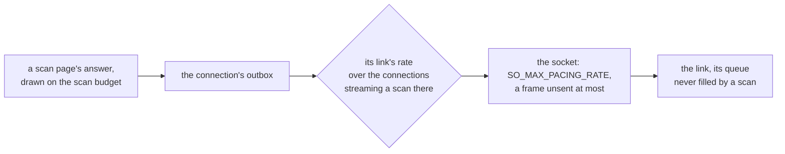

# F147. A scan's answers paced by a share of their link

## Context

A scan of archived rows is paced by its device: a share of the device's busy time a second, under
a byte ceiling, with a trickle beside a foreground read ([F119](scan-pacing.md),
[F128](device-time-pace.md)). A resident row is read from memory, and nothing paced it. So a scan
of a resident table went as fast as its client's link carried it.
[W7](../future-work/scans/isolation.md#network) said so: "nothing here shares out the link
itself".

[M24's lab exit](../future-work/scans/m24-exit.md) measured what that costs (2026-11-12). titan's
node scanned resident rows to europa over 1 GbE at 110.6 MiB a second, a gigabit. The client's own
reference cell went over W7's budget:

- its read p99 went from 0.46 ms to 1.6 ms, 3.5 times;
- its insert p99 rose 1.63 times;
- its rate fell by a sixth.

The node's shards were each under a quarter of a core meanwhile. That is
[item 390](../appendix/resolved/resident-scan-fills-the-link.md).

The fix direction was the user's to choose. They chose, on 2026-11-13, that **the node paces a scan's
answer bytes on the wire**: it needs nothing from the client, and it protects every client of the
node, not only the scanner's own foreground. **Its default is a share of the node's link speed**, read
from the interface each connection leaves by.

## What it does

- **A node reads its links once, at its start** (`server/link_pace.rs`, `Links::read`).
  - Every address an interface holds comes from `getifaddrs`, and each interface's speed from
    `/sys/class/net/<if>/speed`.
  - Each link's scans get `scans.link_share` of that speed, together. Each link is said at INFO,
    for example `enp3s0 1000 Mbit/s, 31,250,000 bytes a second`.
  - **Loopback is never paced**: it shares no wire.
  - An interface that reports no speed (`-1`, as `docker0` does) is taken at `scans.link_speed` if
    the config names one, or else at a gigabit (`ASSUMED_LINK_SPEED`), the narrowest link a node is
    likely to share. So is an address no interface held at the start.
  - A named `link_speed` stands in for every link's reading but loopback's.
- **A connection writing a scan's answer is paced to its part of its link's rate**, by its own
  write relay (`ConnPace`, in `write_replies`).
  - Before each frame of a scan's answer, its opener or a data frame, the relay reads its link's
    rate shared out among the connections now writing a scan's answer there (`LinkPace::rate_each`,
    one atomic load).
  - The relay asks the kernel only when that part changed, through `SO_MAX_PACING_RATE`. The kernel
    spaces the connection's packets at no more than that rate, with TCP's own pacing where the
    queueing discipline does none.
  - On a connection's first paced frame, its unsent bytes in the kernel are bounded to a data frame,
    `SCAN_DATA_FRAME_BYTES` (`TCP_NOTSENT_LOWAT`). The rest of its answers wait in the outbox, on
    the scan budget's draw.
- **A connection counts on its link while it owes a scan's answer.** A guard (`Streaming`) is taken
  at its first scan frame. It is dropped once its outbox holds no scan stream, after a frame is
  written or a cancel took answers back, and when its relay ends.
- **Another stream's frame lets the socket go** once the connection owes no scan's answer: its pace
  becomes none and its unsent bound the host's again.
  - That stream may be an object's or a long table answer's.
  - A whole frame asks nothing.
  - So a connection that carries both kinds is paced only while a scan streams on it.
- **A client's scans ride connections of their own** (`Shoal::scan_pool`): as many as are set apart
  for long streams, and apart from them. So a client's object answers are never on a connection
  its node paces.
- **A node's figures carry its links' paces**, in `ScanFigures`:
  - `link_rate`: the largest rate of a link that paced a connection;
  - `link_streaming`: the connections writing a scan's answer now;
  - `link_paced`: the connections paced since the start;
  - `link_rates_set`: the times a pace was set.

```yaml
scans:
  link_share: 25%        # of each link's speed, every scan answer leaving by it together; null for none
  link_speed: 2.5Gbit    # in place of what every interface but loopback reports; read from each unless set
```



## Design choices

**The kernel paces, not the writer.** A token bucket in the writer would release a 256 KiB data
frame at a time, and TCP would send each at the link's speed: a burst of two milliseconds at a
gigabit that fills the NIC's queue as surely as an unpaced scan does, only less often. At p99 a
small answer meets one of those bursts. The kernel's pacing spaces the connection's packets
themselves, so they never stand in the link's queue together. The rate is a socket option any
process may set on its own socket, and nothing needs fq.

**A share of the link, as `device_time` is a share of the device.** A fixed byte rate is a quarter
of one link and a fortieth of another. The node reads the speed of the interface each connection
leaves by. It cannot see a link beyond its own, so a client on a slower link than its node's is
not protected by it: that is a limitation, below.

**Shared out among the connections streaming a scan, and read at each frame.** A per-connection
rate would let a client open as many connections as it likes and take a share each. The link's
rate divided by its streaming connections bounds them together. Each connection learns its part at
its next frame, a data frame at most after another begins or ends.

**Only a connection's own write relay touches its socket.** Setting every member's rate from the
one that joined would need every member's descriptor. A descriptor is reused once it is closed, so
a pace set from another task could land on another connection or on a file.

**The unsent bound.** Paced, a connection drains slower than its writer writes. Without a bound the
kernel would hold up to `tcp_wmem`'s maximum of every paced connection's answers, outside
`node_memory` and outside the scan budget, and cancels would cut nothing already handed over.
Bounded to a frame, the answers wait where their draw holds them.

**A client's scans apart from its objects.** The node paces a connection while it writes a scan's
answer, whatever else rides it. The client's long-stream pool carried both until now. Its object
answers would have been held to a scan's share while a scan streamed on the same connection, so
the scans get a pool of their own.

## Alternatives rejected

- **The client holds its scan back** (fewer bytes in flight, or asks paced), offered with the item.
  It protects only that client's own foreground: another client on the node's link, or a client
  that does not hold back, is not protected. The user chose the node's pace. A client's own ask, for a
  link slower than its node's and for M25's many nodes into one client, is filed in
  [the todos](../appendix/todos.md#a-clients-own-asked-pace-for-its-scans).
- **Reading W7's clause as the device's**, the link left to the deployment. It was offered, and not
  chosen.
- **A fixed byte ceiling as the default.** It is simpler. But it is the wrong share of every link but
  one, and the user chose the share.
- **A writer's token bucket alone**, and why the kernel's pacing is needed beside any average:
  above.
- **BBR or TCP-LP on the scan's connection.** BBR keeps a small queue but takes the whole link.
  TCP-LP yields to other flows by one-way delay, which on a LAN of sub-millisecond round trips its
  millisecond timestamps cannot see. Neither is a share.
- **Pacing every connection of a node.** A table's answer and an object's are the foreground, which
  W7's budget protects.

## Limitations

- **The node sees its own link alone.** A client on a slower link than its node's is not protected:
  a node on 2.5 GbE paces a scan at a share of 2.5 Gbit/s, which can fill a client's gigabit. Its own
  ask is filed in [the todos](../appendix/todos.md#a-clients-own-asked-pace-for-its-scans), with the run on a
  2.5 GbE europa that measures it.
- **Speeds are read at the start.** A link that renegotiates its speed, or an address added later, is
  paced as it was read, the unknown link's speed for the latter.
- **An interface that misreports**, as a container's veth reports 10 Gbit/s, is paced at that.
  `scans.link_speed` names the truth.
- **A share a link, not a share a principal.** One client's scans may take a link's whole share
  from another's. ~~A count of scans a principal is W7's later addition, beside
  [item 380](../appendix/resolved/unread-scan-answers-bounded.md).~~ [F148](scan-shares.md) shares a shard's scan
  class and the scan budget among principals, never a link: what a principal's pages read is paced as anyone's.
- **No floor on a connection's part.** A thousand connections streaming at once each crawl at a
  thousandth, and their pages may give up. The bound holds under abuse instead.
- **The pace bounds what the link adds, not what is left beside it.** Beside a paced scan of
  resident rows the reads on the node still wait about 0.4 ms longer at p99
  ([item 391](../appendix/resolved/paced-scan-reads-and-inserts.md)). That wait is in titan's network path: a paced
  flow of the same rate with no Shoal in it costs as much, and W7's read clause is judged against that flow.
- **Only a client's scan answers are paced.** A driver's walk over the peer lanes, an operator's walk
  on the admin verb, and an object read are not.
- **A connection that carries an object and a scan at once** paces the object while the scan streams.
  A client of this build never does.

## Invariants to uphold

- **Only a connection's own write relay sets its socket's pace**, and never a descriptor another
  task may have closed.
- **A connection counts on its link through a guard dropped when it owes no scan's answer**, never
  through a pair of calls: its relay's end must uncount it.
- **The pace is set before every frame of a scan's answer**, the opener included, and **the kernel is
  asked only when the connection's part changed**.
- **A paced connection keeps at most a data frame unsent in the kernel.** The rest of its answers
  wait in the outbox, drawn on the scan budget.
- **Loopback is never paced** unless a test asks (`faults::pace_loopback`).
- **No client input reaches an interface's path**: a name is joined to `/sys/class/net` only if it
  is a short word with no path in it.
- **A whole frame never asks the pace anything**, so a table query's answer path is as it was.

## Performance

**Nothing on a table query's path.** A whole frame never reaches the pace, and a table query's
answer is a whole frame. A scan's frame costs one atomic load, and a `setsockopt` only when its
part of the link changed. An object stream's frame costs a branch while the connection was never
paced.

**On the lab** ([the sweep](../future-work/scans/link-pace.md#the-sweep), 2026-11-13). The share
was swept on M24's exit's resident arm: titan's node, europa's client, a gigabit, four rounds.

| Arm | Scan's bodies, MiB/s | Cell's read p99 ratio | Insert p99 ratio | Cell's read median, µs |
| --- | --- | --- | --- | --- |
| The cell alone | - | 1.00 | 0.98 | 242 |
| No pace | 110.4 | 3.33 | 1.59 | 552 |
| 12.5% | 14.9 | 1.88 | 1.16 | 244 |
| **25%, the default** | 29.8 | 2.07 | 1.16 | 253 |
| 50% | 59.5 | 2.27 | 1.42 | 314 |
| 75% | 89.1 | 3.02 | 1.66 | 664 |

- **The pace binds where it is set**, 95 to 100% of the share of 125 MB a second.
- **It takes off the link's part**: at a quarter and under, the cell's read median is its own, and
  titan's NIC's softirq falls from 38% of its cpu to 10%.
- **No share holds W7's budget.** The rest of the rise is ~~the node's own cost~~, for reads, titan's network
  path, which a paced flow with no Shoal in it costs as much, and for inserts the scan's own, beside another
  client's cell too ([item 391](../appendix/resolved/paced-scan-reads-and-inserts.md)). The insert part was a scan's
  unpaced reads of its map ([Resolved #392](../appendix/resolved/scan-map-reads-paced-and-read-ahead.md)). With that
  fixed, M24's confirmation (2026-11-14,
  [the record](../future-work/scans/link-pace.md#the-confirmation)) held the budget at this default over eight rounds:
  - the inserts within it at the median beside every resident scan, at 1.00 to 1.04;
  - the reads overlapping their twin's, the cell beside a paced bulk flow of the scan's rate.
- **A paced scan passes 100 µs in three times the share of its steps the unpaced scan does**: 88
  to 115 in 10,000 against 32. Its steps find the shard idler. In the confirmation, with item 392's fix, it was 100 to
  139, kept apart from M24's step clause as
  [O180](../appendix/optimizations.md#o180-a-paced-resident-scans-encode-steps-run-past-their-bound-on-their-own-cpu-about-once-in-ninety).
- **The default is a quarter**, chosen with the user. It cost the inserts what an eighth did and
  the read p99 0.09 ms more, for a scan twice as fast.

## Tests

| Test | Proves |
| --- | --- |
| `a_pacing_rate_and_unsent_bound_are_set_on_the_socket` (`shoal-proto/src/shared/sockets.rs`) | A rate past four bytes' reach reads back whole, none reads as none, and the unsent bound reads back and is put back by zero |
| `a_links_speed_is_read_from_its_interface` (`shoal-core/src/server/link_pace.rs`) | A speed file's megabits are its speed, and -1 or text is none. Every address of a device, an alias's and a mapped v4's among them, shares its link |
| `a_loopback_link_is_not_paced` (same) | Loopback is unpaced, and its speed is never read. The test fault paces it at the named speed |
| `an_unknown_speed_takes_the_named_or_one_gigabit` (same) | An interface reporting none, and an address no interface held, take the named speed or a gigabit. A named speed stands in for every interface's |
| `a_links_share_is_divided_among_its_streaming_connections` (same) | A link's rate is divided by the connections counted on it, and each one's guard uncounts it |
| `a_connection_is_paced_only_while_a_scan_streams` (same) | The first scan frame bounds unsent bytes and paces, and an unchanged part asks nothing. A second connection halves both parts. A connection owing none is uncounted, and the next object frame lets its socket go. Loopback and a node without links are never paced. A refusing socket leaves its connection unpaced |
| `an_interface_name_never_leaves_its_directory` (same) | A name with a path in it, a dot or a space is never joined to a path |
| `a_link_share_and_speed_parse_and_are_refused_out_of_range` (`shoal-core/src/server/conf.rs`) | Percents and speeds read and write back. `null` paces nothing. A share of nothing, or past all of it, is refused by name |
| `a_nodes_link_paces_are_its_own_and_read_as_none_from_before` (`shoal-proto/src/shared/protocol/stats.rs`) | Shards' link figures keep the later read, and a build's figures from before them read as none |
| `a_resident_scan_is_paced_to_its_links_share` (`shoal/tests/scan_link_pace.rs`) | 5.1 MB of resident rows at a share of 5 MB a second take at least a second, where unpaced they came in 193 ms and the test failed. The node reports the rate, and no connection streaming afterwards |
| `two_scans_on_one_link_share_its_pace` (same) | Two clients' scans together leave at no more than one share: unpaced, 10.2 MB came in 354 ms and the test failed |
| `a_scan_over_loopback_is_not_paced` (same) | With no fault, a node paces nothing on loopback |
| `a_scan_takes_connections_of_its_own` (`shoal/tests/scans.rs`) | A scan opens the scans' connections and none of those set apart for long streams |

## Related

- [Item 390](../appendix/resolved/resident-scan-fills-the-link.md), which this cures.
- [W7](../future-work/scans/isolation.md#network), the rules on the wire.
- [F119](scan-pacing.md) and [F128](device-time-pace.md), the device's pace this is the link's twin
  of.
- [F144](scan-pages-on-the-wire.md), the frames it paces, and [F145](scan-driver.md), the client's
  driver.
- [Resolved #304](../appendix/resolved/lone-frame-loss-probe.md) and
  [F112](object-congestion.md), the other socket options a client's connection takes.
- [The lab's record](../future-work/scans/link-pace.md).
