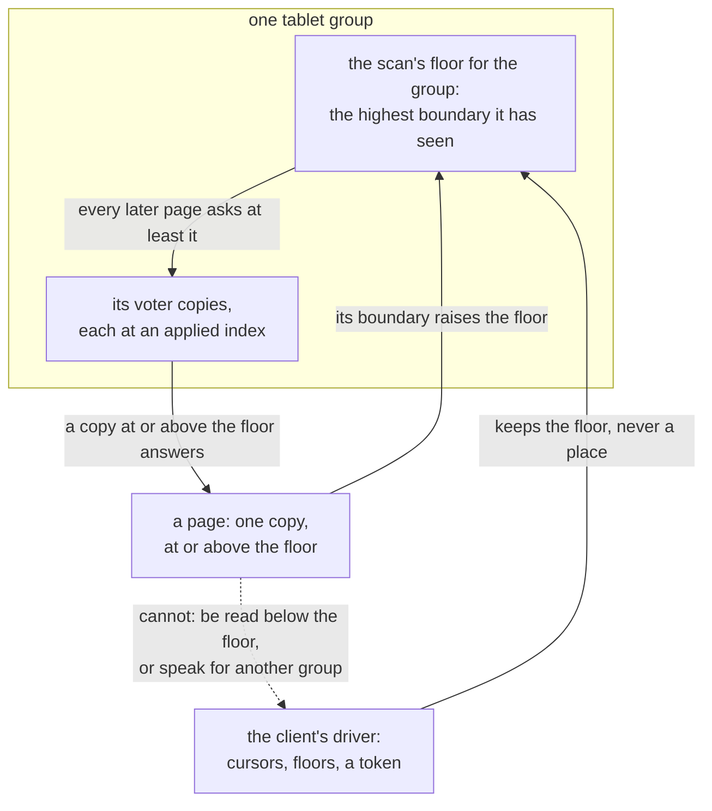

# W13. The contract and the questions

## Context

A scan reads a table while it is being written, from copies that move, fail and restart, for a
client that may itself stop and start again. What it promises has to be written down as properties a
history can be checked against, before a frame or a reader is built, as the cluster's contract was
([C13](../../distributed/protocol.md#the-contract)) and the object store's after it
([S18](../../object-storage/contract.md#the-contract)). This page states the scan's contract, how it
behaves under each failure, the questions still open with the gate each blocks, the decision record,
and the acceptance index.

## What exists today

- **A tablet group's contract, P1–P6** ([C13](../../distributed/protocol.md#the-contract)): an order of
  committed commands applied alike on every copy, read levels `One` and `Quorum`, and nothing promised
  across two tablets ([P6](../../distributed/protocol.md#the-contract)).
- **The walk's promise**, decided with the user on 2026-10-13: a walk is monotone from a floor, a page
  read from its copy's state when it begins, every partition live when the first page begins and still
  live when the walk reaches its key handed out once, in ascending key order, never older than the
  floor; nothing held between pages
  ([Q17's record](../../object-storage/contract.md#q17-in-part-what-a-driver-asks-the-tablet-walk-for-2026-10-13)).
- **The object store's contract, P7–P19**, of which P19 states what objects do not promise
  ([S18](../../object-storage/contract.md#the-contract)).

## The design

### Decisions taken and directions preferred

| Decision | Status |
| --- | --- |
| The first listing lists every live object, unordered, with stat fields and no bytes | Taken 2026-10-25 ([overview](overview.md#decisions-taken-on-2026-10-25)) |
| Ordered scans are an order declared in the schema | Taken 2026-10-25 |
| A scan needs a privilege of its own | Taken 2026-10-25 |
| Pages only move forward; no snapshot mode | Taken 2026-10-25 |
| The contract, P20–P26, as [the table below](#the-contract) has it | Agreed 2026-10-29 ([the record](#before-m22-the-contract-agreed-2026-10-29)) |
| A scan's own rate and its cost are judged at M23 | Taken 2026-10-29 ([W42](scan-speed.md)) |
| A scan's goal is its ceiling, reached cheaply; past it is X18's and Q37's | Taken 2026-10-29 ([W42](scan-speed.md)) |
| The walk, rebuilt for load, is the one per-tablet reader | Preferred ([Q33](#questions-to-answer)) |
| A tablet's records are kept together by merges written in key order | ~~Preferred~~ Taken 2026-10-30 by X37's record, built as [F121](../../features/merges-in-key-order.md); consolidated blocks still open ([Q62](#questions-to-answer)) |
| The client drives; no server holds a scan between pages | Preferred ([W6](distribution.md)) |
| Which copies a scan reads, and how its levels are served | Taken 2026-11-14 by design ([the record](#q38-which-copies-a-scan-reads-and-its-levels-2026-11-14)): voter copies alone, held by the client's map and the node's own membership; a level resolved once at a scan's start; a floor waited for at most 250 ms; one barrier a group as a get's; a caller's session tokens the floors a scan begins with. ~~Which voter copy a scan prefers is [X38](copies-two-ways.md)'s, by the user's decision~~ Which voter copy a scan prefers measured by [X38](copies-two-ways.md) the same day, by the user's decision: followers then leaders, every tablet dealt once to a lane a member and a member out of tablets taking one it follows, then one it leads ([Q38](#questions-to-answer)) |
| Answers carry rows encoded on the shard | ~~Preferred~~ Taken 2026-11-06 with the user ([the record](#q35-what-a-scans-answer-carries-2026-11-06)): rows by default, and partitions as the walk hands them out for an unfiltered, unprojected scan that asks for them ([Q35](#questions-to-answer)) |
| The cursor and the frames, as [W4](cursor-and-pages.md) has them | Taken 2026-11-06 by design ([the record](#q36-the-cursor-and-the-frames-2026-11-06)): a page's progress one key, cursors that are keys with a sort-key position reserved, floors a group learned from the answers, `ScanPage` and `ScanAnswer` of fixed heads, and a resume token that is checked and not signed ([Q36](#questions-to-answer)) |
| Scan work runs on the table shards, in a class of its own, under a ceiling | Preferred ([Q37](#questions-to-answer)) |
| A declared order is kept by an index in each tablet | Preferred ([Q40](#questions-to-answer)) |
| A coordinator-driven scan | Not in these gates ([Q42](#questions-to-answer)) |
| A snapshot across groups | Excluded: no mechanism exists, and the decision of 2026-10-25 asks for none |

### The contract

`P` numbers continue [S18's](../../object-storage/contract.md#the-contract) and are never reused. P1–P6
bind scans unchanged: a page reads a tablet group's copy. P20–P26 are what scans add, each written as
a property a history can be checked against, beside the violation that breaks it.

| # | Property | Binds | The violation | Owning tests |
| --- | --- | --- | --- | --- |
| P20 | **Once.** For each group a scan reads, every partition live at the group's floor and still live when the scan reaches its key is handed out exactly once, however the scan is retried, moved between copies, carried through a failover, a move of its replica set or a node's restart, or resumed from a token by another client. Since [X19](#x19-measured-the-edges-decided-with-the-user-2026-11-07) (2026-11-07, with the user), restated for a sorted partition too large for one page, handed out in pieces across pages: each of its rows live at its group's floor and still live when the scan reaches it is handed out exactly once, and the pieces of one partition each read at or above the floor | [W4](cursor-and-pages.md), [W6](distribution.md) | A partition handed out twice after a page was asked again of another copy; one live throughout missed after a move; a row of a partition split across pages handed out by two pages, or by none | `a_scan_hands_out_every_live_partition_once` (M24), `a_scan_survives_a_copy_killed_under_a_page` (M25), `a_scan_survives_a_move_of_its_tablets` (M25), `a_scan_resumes_from_its_token_after_the_client_restarts` (M25) |
| P21 | **Pages move forward.** No page of a group is read at a state older than the scan's floor for that group, and a floor never lowers; every row a page hands out is its copy's state at or after the page's boundary | [W5](tablet-reader.md), [W6](distribution.md) | A page from a copy restarted behind the floor; a resident partition encoded after the plan and folded over the plan's older view | `a_scan_never_reads_below_its_groups_floor` (M25), `an_evicted_partition_is_read_from_its_archive_at_or_after_the_boundary` (M23), `a_swept_overlay_never_brings_a_deleted_row_back` (M23) |
| P22 | **Read levels.** At `One` a page is a whole voter copy's committed, applied state: never an entry not committed, never a copy starting, installing, quarantined or learning. At `Quorum` every write acknowledged in a group before the scan's first page of it began is visible to every page of the group. A listing at `Quorum` lists every object whose put was acknowledged before it began, and none whose delete was | [W6](distribution.md), [W9](bucket-listing.md) | A page from a copy that began an install while it read; a `Quorum` page missing an acknowledged write; a listing showing an object deleted before it began | `a_scan_at_one_never_shows_an_uncommitted_write` (M25), `an_install_under_a_page_refuses_it` (M23), `a_quorum_scan_takes_one_barrier_a_group` (M25), `a_scan_never_reads_a_learner` (M25), `a_quorum_listing_sees_every_acknowledged_put_and_no_acknowledged_delete` (M26) |
| P23 | **What is not promised.** No two groups are read at one moment; no page is more than its copy at its boundary; a partition made or removed while a scan runs may or may not be handed out; a scan's order across tablets is unspecified; a scan is not a consistent copy. This is [P6](../../distributed/protocol.md#the-contract)'s twin, and [P19](../../object-storage/contract.md#the-contract)'s | every page | An oracle, an API or a test that treats a scan as a snapshot, or its order across tablets as meaningful | The oracle's scope in `scan_oracle_promises_nothing_across_groups` (M22) |
| P24 | **Explicit and granted.** A scan runs only when asked for as a scan, for a principal holding `scan` on its table or bucket; no query becomes a scan by naming no key; a client never names a generated table | [W10](api.md), [W9](bucket-listing.md) | A get with no keys reading a table; a principal with `read` alone scanning; a scan naming `ObjectMeta` | `a_get_with_no_keys_is_still_refused` (M24), `a_scan_needs_its_grant` (M24), `a_listing_needs_the_buckets_scan_grant` (M26), `a_generated_table_is_still_refused_by_name` (M26) |
| P25 | **Positions, never places.** A scan's cursor and resume token name tablets, keys and group floors, never a node, a slot or an executor; a move, a failover, a restart or a split of a tablet leaves them valid; a change of the table's schema refuses them by name | [W2](ordering.md), [W4](cursor-and-pages.md) | A token that names a node failing after a move; a token accepted by another table or schema | `a_resume_token_resumes_and_is_refused_for_another_table` (M24), `a_position_survives_a_split_of_its_tablet` (M24) |
| P26 | **Ordered, once.** An ordered scan of a declared order hands out the partitions of its placement value between its bounds in the order of their encodings, each once, and a tablet's order index holds exactly its live partitions | [W8](declared-order.md) | A partition out of order after a spread's merge; an index entry left for a partition removed | `an_ordered_scan_hands_out_a_placement_values_partitions_in_order` (M27), `a_spread_scan_merges_its_buckets_in_order` (M27), `the_index_and_its_rows_change_in_one_apply` (M27) |

**Isolation is a budget, not a property.** What a scan may cost the queries beside it is a number,
stated on [W7](isolation.md#the-budget) and judged on the lab at every gate from M23; no history can
check it, so it is not in this table, and no gate passes without it.

### How a scan behaves when something fails

| Condition | Required behaviour |
| --- | --- |
| A copy dies under a page | The page is asked again of another copy with the same cursor and floor, and nothing is handed out twice |
| A copy is starting, installing, or behind the floor | Refused `Unavailable` by name; the driver reads another copy. Since [Q38](#q38-which-copies-a-scan-reads-and-its-levels-2026-11-14) a copy behind the floor first waits up to 250 ms for its apply to reach it, and a copy a full disk froze refuses at once |
| A copy is a learner, or its membership as applied names its node no voter | Since Q38: refused `Unavailable` by name; another copy |
| A group's barrier at `Quorum` cannot be taken | Since Q38: the group's tablets refused `Unavailable`; asked again, of the copy or another |
| A caller's session token names another cluster or another table | Since Q38: refused by the client before any page is sent |
| An answer puts a caller's session token's tablet in another group | Since Q38: the scan ends `UnknownLineage`, none of the page handed on |
| A copy is quarantined | Refused `Quarantined`; another copy |
| A replica set moves | The old copy refused `StaleTopology`; the new one read from the cursor and the group's floor |
| A node restarts | Its copies refused until they are whole and at the floor |
| A shard's scan class is full, or its budget cannot be drawn in 250 ms | Refused `Shedding`; the driver backs off |
| A partition's archive moves under a page | Read where the map says it is now |
| An install begins under a page | The page refused, none of its rows sent |
| Another shard of the node hosts a tablet a page asked | That tablet refused `HostedElsewhere`; the client asks the node for it in a stream of its own ([W4](cursor-and-pages.md#what-one-page-is)) |
| A page is read below a floor the client holds for one of its groups, on a tablet whose group it had not learned | The page dropped whole, none of its rows handed on, and asked again with the floor ([W4](cursor-and-pages.md#which-group-a-tablet-is-in)) |
| The client goes away | Its pages in flight cancelled; nothing held anywhere |
| The client restarts | It resumes from its token |
| The table's schema changes | The token refused by name |
| A token is damaged, or names another cluster or another scan | Refused by name before any page is sent ([W4](cursor-and-pages.md#the-resume-token)) |
| An answer cannot be right | No row of its page handed on; the scan ends by name, resumable from its token |

### Questions to answer

`Q` numbers continue [S18's](../../object-storage/contract.md#questions-to-answer). Each names the gate
it blocks, the evidence that settles it, and the direction preferred until then.

| # | Question | Gate | Evidence | Preferred |
| --- | --- | --- | --- | --- |
| Q33 | What reads a scan's page: F87's walk rebuilt, or a reader of its own? | Before M23 | [X16](spikes.md#x16-the-walk-beside-the-foreground), [X17](spikes.md#x17-a-page-rebuilt) | The walk rebuilt, the drivers moved onto it ([W5](tablet-reader.md)). **Settled 2026-10-31** by M23's exit ([the record](#m23s-exit-measured-evidence-for-q33-q34-and-q37-and-q62-settled-2026-10-31)) |
| Q34 | What may a scan cost the foreground, and what pace holds it? | Before M23 | X16 ([measured](#x16-measured-evidence-for-q33-q34-and-q37-none-settled-2026-10-29): the walk outside the budget, the pace at its defaults never binding), X20 ([run](#x20-run-evidence-for-q33-q34-and-q37-none-settled-2026-10-29): ScyllaDB's unpaced scan doubled the tail), [X18](spikes.md#x18-table-reads-paced-by-idle-time) | `max(1.10 × alone, alone + 0.1 ms)`; idle time, a ceiling near 100 MiB/s ~~a node~~ a device, a trickle ([W7](isolation.md)); since M23's plan (2026-10-31, with the user) a share of each device's busy time, near 75 ms a second and learned from the scan's own reads, under that byte ceiling, and a device-wide bound on a scan's reads in flight ([F128](../../features/device-time-pace.md)), judged at M23's exit: the read clause held, ~~the insert clause and the share's default left to the user~~ the insert clause read as defined on rounds run again with a cell whose feed does not wrap, and the share kept at 75 ms, both decided with the user the same day ([the decisions](m23-exit.md#decided-with-the-user-2026-10-31)) ([the record](#m23s-exit-measured-evidence-for-q33-q34-and-q37-and-q62-settled-2026-10-31)) |
| Q35 | What does a scan's answer carry? | Before M24 | X17's encode figures | Rows encoded on the shard, filtered and projected there ([W4](cursor-and-pages.md#the-answer-scananswer)); since X17 (2026-10-30) with an unfiltered scan's opt-in to partitions as they lie moved forward, rows costing the shard 1.3 to 2.9 times what partitions cost a client ([the record](#x17s-second-half-measured-evidence-for-q33-and-q35-none-settled-2026-10-30)). **Settled 2026-11-06** with the user: rows encoded on the shard for every scan by default, and partitions for an unfiltered, unprojected scan that asks for them, under a layout version of their own, each page's rows handed on only once its answer is whole and validated ([the record](#q35-what-a-scans-answer-carries-2026-11-06)) |
| Q36 | What does a cursor hold, and what are the frames? | Before M24 | Design, and the code as M23 left it | [W4](cursor-and-pages.md). **Settled 2026-11-06** by design ([the record](#q36-the-cursor-and-the-frames-2026-11-06)): a page's progress across its tablets is one key; a cursor is a key, at most 64 a request, each with a sort-key position reserved; floors are kept a group, each tablet's group learned from the answers and a page below a floor the client holds dropped; `ScanPage` (32) and `ScanAnswer` (33) are fixed heads of 96 and 80 bytes with their sections, the body chunks of a 32 byte head in data frames of 256 KiB; a resume token is checked by a CRC and not signed. X19 decides, with the user's leave, whether M24 splits a sorted partition across pages in the reserved position; ~~decides~~ decided 2026-11-07, with the user: it does, from records of bounded size ([the record](#x19-measured-the-edges-decided-with-the-user-2026-11-07)) |
| Q37 | Does scan work stay on the table shards, or move to executors of its own so a scan can run at a device's speed? | The default before M23; asked again after M25 | X16, X18, [X20](scylladb-scan-sources.md) ([W42](scan-speed.md#past-the-ceiling)) | On the shards, under a ceiling, the cpu-heavy part written so it can move ([W7](isolation.md#cpu)) |
| Q38 | Which copies does a scan read, and how are its levels served? | Before M25 | Design; since 2026-11-14 [X38](spikes.md#x38-which-copies-a-scan-reads-two-ways) for the copy a scan prefers | Voters only, followers first, one barrier a group ([W6](distribution.md)). ✅ **Settled 2026-11-14** ([the record](#q38-which-copies-a-scan-reads-and-its-levels-2026-11-14)), ~~in part~~ by design: voters only, at both ends; the level resolved once at a scan's start; at `One` a floor waited for at most 250 ms; at `Quorum` one barrier a group, taken as a get's; a caller's session tokens the floors a scan begins with. ~~Which voter copy a scan prefers, followers then leaders or every voter alike, is X38's, by the user's decision the same day~~ And by X38 the same day, the user's decision: followers then leaders, dealt evenly and taken by whichever member is free, since every voter alike read no faster and the rule gives a tie to followers |
| Q39 | Does `all` include `scan`? | ~~At M25, with the user~~ Before M24's grant, with the user | — | ~~Open: including it widens every grant of `all` made before; leaving it out makes `all` mean less than everything~~ **Settled 2026-11-10** with the user, ahead of its gate, since M24 reads `scan` from a standalone node's file and has to say what `all` means there: **`all` includes `scan`**, so `all` is read, write and scan. In a standalone node's file, read at every start, every grant of `all` made before scans existed reaches a scan of its table; a cluster's committed grants are names, so one committed before as `read` and `write` stays those two, and M25 decides what its activation does with them ([F140](../../features/scan-frames.md)). `read` still never implies `scan` ([W10](api.md#grants)) |
| Q40 | How is a declared order kept? | Before M27 | [X21](spikes.md#x21-declared-order-priced) | An index in each tablet, maintained at apply ([W8](declared-order.md)) |
| Q41 | How is a bucket listed in path order? | Before M28 | [X22](spikes.md#x22-the-ordered-listing-two-ways) | An ordered `ObjectMeta` on W8's index for new buckets; Q32's index if existing ones must list in order ([W9](bucket-listing.md#the-ordered-listing-a-later-gate)) |
| Q42 | Is a scan ever coordinated by a node, for a client that is not Rust or a gateway that should not know the topology? | None set | — | Not in these gates ([W6](distribution.md#no-coordinator)) |
| Q62 | Does a table's archive keep a tablet's records together, so a scan can read them in runs, and what may that cost a merge? | Before M23 | [X37](spikes.md#x37-a-tablets-records-together-priced) | Merges written in key order, nothing rewritten; consolidated blocks only if X37 finds a tablet's stretches too short for W12's cost budget ([W42](scan-speed.md)). Settled in part 2026-10-30: the layout taken, consolidation left to M23's plan ([the record](#x37-and-x17s-reads-half-measured-evidence-for-q33-q34-and-q37-and-q62-settled-in-part-2026-10-30)). **Settled 2026-10-31** by M23's exit: no consolidation, a churned table's runs reading 10.6 partitions a device read ([the record](#m23s-exit-measured-evidence-for-q33-q34-and-q37-and-q62-settled-2026-10-31)) |

### Decision record

#### The plan drawn, and four decisions taken with the user (2026-10-25)

| Decision | Evidence |
| --- | --- |
| **The first listing gate lists every live object, unordered**, each with its path, size, ETag and modified time and none of its bytes; path order, a prefix and a delimiter are a later gate | Taken with the user. An unordered listing is a scan with a projection; an ordered one needs an order index and a choice between two layouts that measurement should make ([W9](bucket-listing.md)) |
| **Ordered scans are an order declared in the schema**: placement fields, order fields, a spread. Keys a caller steps through, a merge of every tablet and range placement stay alternatives | Taken with the user, choosing among the four on [W2](ordering.md#the-levers) |
| **A scan needs a privilege of its own** | Taken with the user. A scan reads a table whole, and a principal that may get rows by key should not thereby read everything ([W10](api.md#grants)) |
| **Pages only move forward**, per group from a floor; nothing across groups; no snapshot mode | Taken with the user: the walk's promise of 2026-10-13, made to clients ([P20–P23](#the-contract)) |

#### Before M22: the contract agreed (2026-10-29)

Recorded 2026-10-29, on the tree of the object store's squash (`4889279e`), before any scan code. The
user was shown P20–P26 as [the contract](#the-contract) has them and agreed them as written: no
property was changed, added or dropped. This settles the first of M22's three inputs
([the milestones](milestones.md#before-m22-the-contract-agreed)); the bench's scan kind and X16's
baseline are the others.

| Decision | Evidence |
| --- | --- |
| **P20–P26 are agreed**, each as [the contract](#the-contract) has it, beside the violation that breaks it and the tests that own it ([below](#the-clauses-as-agreed)) | Agreed with the user. P20–P23 are the walk's promise of 2026-10-13 made to clients, which F87 already keeps for its drivers ([Q17's record](../../object-storage/contract.md#q17-in-part-what-a-driver-asks-the-tablet-walk-for-2026-10-13)); P24 is the decision of 2026-10-25 that a scan needs a privilege of its own; P25 keeps a scan's state to positions, as F87's cursor already is; P26 is declared order's, judged at M27 |
| **The failure table is the required behaviour** ([How a scan behaves when something fails](#how-a-scan-behaves-when-something-fails)) | Each row is P20–P22 applied to one condition, so it binds every gate a client can reach, and its refusals are the walk's own codes today |
| **Isolation stays a budget, not a clause** | No history can check a latency, so [W7](isolation.md#the-budget)'s budget is judged on the lab at every gate from M23, and no gate a client can reach passes without it |

##### The clauses as agreed

Every clause, the violation that breaks it, and the tests on the owning pages, each naming its gate.
No clause has a model of its own: unlike P7–P19, which X1's model checks from durable facts
([S18](../../object-storage/contract.md#the-clauses-as-agreed)), these are judged by the fixture's scan
oracle from M22, a check for each group against its committed history.

| Clause | The violation | Owning tests |
| --- | --- | --- |
| P20 Once | A partition handed out twice after a page was asked again of another copy; one live throughout missed after a move | `a_scan_hands_out_every_live_partition_once` (M24), `a_scan_survives_a_copy_killed_under_a_page` (M25), `a_scan_survives_a_move_of_its_tablets` (M25), `a_scan_resumes_from_its_token_after_the_client_restarts` (M25) |
| P21 Pages move forward | A page from a copy restarted behind the floor; a resident partition encoded after the plan and folded over the plan's older view | `a_scan_never_reads_below_its_groups_floor` (M25), `an_evicted_partition_is_read_from_its_archive_at_or_after_the_boundary` (M23), `a_swept_overlay_never_brings_a_deleted_row_back` (M23) |
| P22 Read levels | A page from a copy that began an install while it read; a `Quorum` page missing an acknowledged write; a listing showing an object deleted before it began | `a_scan_at_one_never_shows_an_uncommitted_write` (M25), `an_install_under_a_page_refuses_it` (M23), `a_quorum_scan_takes_one_barrier_a_group` (M25), `a_scan_never_reads_a_learner` (M25), `a_quorum_listing_sees_every_acknowledged_put_and_no_acknowledged_delete` (M26) |
| P23 What is not promised | An oracle, an API or a test that treats a scan as a snapshot, or its order across tablets as meaningful | The oracle's scope in `scan_oracle_promises_nothing_across_groups` (M22) |
| P24 Explicit and granted | A get with no keys reading a table; a principal with `read` alone scanning; a scan naming `ObjectMeta` | `a_get_with_no_keys_is_still_refused` (M24), `a_scan_needs_its_grant` (M24), `a_listing_needs_the_buckets_scan_grant` (M26), `a_generated_table_is_still_refused_by_name` (M26) |
| P25 Positions, never places | A token that names a node failing after a move; a token accepted by another table or schema | `a_resume_token_resumes_and_is_refused_for_another_table` (M24), `a_position_survives_a_split_of_its_tablet` (M24) |
| P26 Ordered, once | A partition out of order after a spread's merge; an index entry left for a partition removed | `an_ordered_scan_hands_out_a_placement_values_partitions_in_order` (M27), `a_spread_scan_merges_its_buckets_in_order` (M27), `the_index_and_its_rows_change_in_one_apply` (M27) |

**What this did not do.** It added no type, frame, file format or dependency of a scan, and no
product code: what changed is this record, the milestones page and the plan's diagram. A clause agreed
here is changed only with a recorded cause, and every page that leaned on it changes with it
([the invariants](#invariants-to-uphold)).

**Not settled.** Q33–Q42 stay open, each at the gate the [questions](#questions-to-answer) name, and
no gate is set: M22 waits on the bench's scan kind and event and on X16's baseline. Until M22 joins
these tables to `shoal-bench/tests/acceptance_tables.rs`, nothing checks that a name above is unique
or that the owning tests exist. Since M22 was delivered (2026-10-30,
[F122](../../features/scan-oracle.md)) the check reads these tables too, and found one name written
on two pages.

#### X16 measured: evidence for Q33, Q34 and Q37, none settled (2026-10-29)

Recorded 2026-10-29 from [X16's record](walk-beside-the-foreground.md): the walk as it stands (F115)
and with W1's four rows (F119) beside the reference cell's shape on the lab, four rounds a side.
Nothing here is decided: each question closes at M23 with X17's and X18's figures beside these.

| Question | What X16 found | What it leaves |
| --- | --- | --- |
| Q34 | Neither side holds the budget beside a scan of a table read from its archives: the cell's read p99 1.13 and 1.12 times, its insert p99 1.60 and 1.63 times; beside a resident sorted table's three-second scan the read p99 1.18 and 1.11 times. The after side's pace never bound, a scan reading about 28 MiB a second a node. ~~The insert tail is the scan's reads beside the WAL's flushes on one device~~ The insert ratio is mostly the lab's 970 EVOs changing their own flush, 0.8 ms to 2.8, about 80 s into each arm and inside its scan; before that the scan cost the insert p99 about a tenth ([Resolved #351](../../appendix/resolved/the-cells-fall-is-the-drives.md), 2026-11-01) | X18, and sharper: which ceiling holds the insert p99 on the 970 EVO, and whether the idle check counts a commit's flush. The preferred pace stands, its numbers open |
| Q33 | A page's hold on its loop is microseconds beside an archived table and up to 6.5 ms for a resident sorted one, whose scan moves the read tail; a page reads its archived partitions one at a time, 154 ms a tablet on the Zen1 hosts | X17: the plan step and runs in disk order are both levers. The walk rebuilt stays preferred |
| Q37 | A scan's rate is its pages' latency, a few percent of what the devices give, not cores | Nothing against the default, on the shards |

#### X20 run: evidence for Q33, Q34 and Q37, none settled (2026-10-29)

Recorded 2026-10-29 from [X20's record](scylladb-scan-sources.md#what-was-run): ScyllaDB 2026.3.4 on
X16's hosts and cpus, X16's cell beside a tablet-era full scan at two requests in flight a replica
shard with `BYPASS CACHE`, four rounds carrying keys and two carrying every row. Another store's
figures, so nothing here is decided either.

| Question | What X20 found | What it leaves |
| --- | --- | --- |
| Q34 | ScyllaDB's scan, unpaced and in its foreground's scheduling group, read about 460 MiB a second a node and doubled the cell's tail while it ran: the read p99 2.34 times, the insert p99 2.15 times, the cell's rate down a quarter, for 2.15 s. Carrying every row to the client, it filled that client's 1 GbE link, and the cell's tail on it went to about 200 ms, the kernel's minimum retransmission timeout | X18 measures its pace against a scan as fast as X17's would be, not today's walk: at that rate the ceiling binds. M24's evidence names the case of one link |
| Q33 | A tablet read in its sstable's order, 13 µs a row on one of 24 requests in flight, where the walk reads its archived partitions one at a time, 210 µs each on the Zen1 hosts alone | X17's runs in disk order are the lever, with a figure beside them |
| Q37 | A scan at many times the walk's rate ran on ScyllaDB's shards, beside its foreground | Nothing against the default, on the shards |

#### W42: a scan's rate and cost judged at M23, its goal the ceiling (2026-10-29)

Recorded 2026-10-29 from [W42](scan-speed.md), with the user, after X20 measured ScyllaDB's scan 40 to
52 times as fast as the walk beside the same cell. The gap is a synced write's flushes on the scan's
device, the members' shares, one read in flight a page and the cpu a partition; past those, the
ceiling and a device's random reads.

| What moved | How |
| --- | --- |
| M23's exit | Judged on [W12](performance.md#the-budgets)'s own rate, idle, up to the ceiling, and on a new cost budget: at least ten partitions a device read, at most a fifth of X16's cpu a partition on Zen1 |
| The goal | The ceiling, reached cheaply; ScyllaDB's rate past it stays X18's ceiling and Q37's cores, priced by the foreground's tail |
| [W1](prerequisites.md#required) | Two required rows for M23's rate: one operation a record read, merges written in key order |
| Q62 | Opened, before M23, [X37](spikes.md#x37-a-tablets-records-together-priced)'s to settle |
| X17 and X18 | X17 profiles a walked partition and adds reads in flight and runs over both layouts; X18 states its ceiling in device time as well as bytes |

Nothing in P20–P26 moved: a sweep of a shard in disk order, which would have read at a device's
speed, needs a cursor naming a file and an offset, a place P25 forbids.

#### X37 and X17's reads half measured: evidence for Q33, Q34 and Q37, and Q62 settled in part (2026-10-30)

Recorded 2026-10-30 from [X17's record](page-rebuilt.md) and [X37's](tablet-records-together.md):
one spike build with a merge's order, a page's reads in flight, a run's gap and a record's operations
behind switches, `Big` loaded fresh in a hash map's order and in key order on X16's side cluster,
four rounds a layout, every scan alone under a pace lifted past the devices' and the cell beside a
scan at the product's pace.

| Question | What they found | What it leaves |
| --- | --- | --- |
| Q33 | The walk with runs in disk order over merges in key order read 1,720,000 partitions a second for the cluster unpaced, eleven and a half times one record at a time, at 5.6 µs of a Zen1 host's cpu and 11.1 partitions a device read: W12's cost budget met. Reads in flight alone gave 3.2 times and 22.3 µs; one operation a record a fifth of a partition's cost one at a time. A page's hold on its loop stayed about 0.11 ms, nothing of `Big` resident | The walk rebuilt stays preferred, its reads W5's with several runs in flight; X17's second half, the plan step and encodes on a resident table, is the rest of Q33 |
| Q34 | At the product's pace, 100 MiB a second a device, a scan in runs read 240,000 partitions a second beside the cell and moved its read p99 1.28 times and its insert p99 1.20 times; one record at a time, 1.11 and 1.30 times (the 1.30 across the 970 EVOs' change of flush, 1.13 to 1.16 before it, [Resolved #351](../../appendix/resolved/the-cells-fall-is-the-drives.md)); runs over hash order, the same bytes in eleven times the device reads, 1.57 and 1.64 times | X18, now against a walk that reads past every ceiling it tries: which ceiling and trickle hold the budget, and the device reads a ceiling stands for |
| Q37 | Unpaced, a Zen1 node's walk in runs read up to 649,000 partitions a second on its shards, its device busy all the time; at the default ceiling about 96,000 | Nothing against the default, on the shards: at a ceiling's rate a Zen1 node's walk in runs spends half a core of its five shards unpaced and about one paced, the difference a page's waits for credit ([O143](../../appendix/optimizations.md#o143-a-paced-scan-pages-waits-for-credit-double-its-cost-a-partition)) |
| Q62 | A merge's sort costs 0.45% of its time and 215 KiB at most; a freshly loaded tablet lies in stretches of 11.3 partitions and a walk in runs reads 11.1 a device read. After twenty minutes of churn, a tenth of the rows overwritten and a tenth added, the stretches halve to 5.9 and runs read 9.9 a device read across the holes (9.5 on the Zen1 hosts), at 6.0 µs a partition | **Settled in part**: merges written in key order, nothing rewritten, is the layout. Consolidated blocks are not settled: the churned table is just under W12's ten, which by the rule named before the run makes them a gate's work; M23's plan decides which, with an hour's churn measured first |

#### X17's second half measured: evidence for Q33 and Q35, none settled (2026-10-30)

Recorded 2026-10-30 from [X17's record](page-rebuilt.md#the-second-half-the-plan-step-encodes-in-steps-and-rows):
a page planned on the loop, its resident partitions encoded a partition a step from the loop's second
inbox, against today's capture, on `Keyword` resident and written into, four rounds; and rows encoded
on the shard against walked partitions, on one core of europa and of titan.

| Question | What X17 found | What it leaves |
| --- | --- | --- |
| Q33 | The plan step held a page's loop 0.0125 ms at p99 against the capture's 0.127, but the longest hold, 5.8 ms, moved into the step that encodes the largest resident partition; a step cost 13 µs and a page waited 38 µs for its steps; the cell's tails did not move beyond their ranges; every tablet of both tables was one page, so a saved position saves nothing there | The walk rebuilt stays preferred, with W5's plan step and its encodes bounded by bytes, a sorted partition in pieces; saved positions stay optional |
| Q35 | Rows encoded on the shard cost it 80 to 280 ns a row past handing a partition out, and spared a client 40 to 220 ns: 1.3 to 1.9 times a partition's client cost for `Big`'s kibibyte rows, 2.5 to 2.9 times for `Keyword`'s small ones | By the spike page's rule an unfiltered scan's opt-in to partitions as they lie moves forward; W11's price for it, a server layout on the wire, is M24's to weigh |

#### X18 measured: evidence for Q34 and Q37, none settled (2026-10-30)

Recorded 2026-10-30 from [X18's record](table-reads-paced.md): the cell beside a scan of `Big` at
eight paces on X17's walk in runs, on the SSDs and with the archives' root on each host's disk, four
rounds a layout, and a supplement of a page's runs in flight at two paces, four rounds.

| Question | What X18 found | What it leaves |
| --- | --- | --- |
| Q34 | The ceiling is the pace: the cell's tails grew with it, and the trickle never engaged beside a warm foreground. On the SSDs only 32 MiB a second a device held the insert p99 (1.07 times); no pace held the read p99, 1.14 times at 32 MiB to 1.65 at 128; two runs in flight a page against sixteen moved it 1.05 against 1.12 times at 32 MiB, the ranges overlapping. A MiB is 2.3 ms of a 970 EVO's time, 0.65 ms of the Optane's, about 125 ms of a disk's, and on a disk no byte pace bound a scan | The default ceiling drops, by the spike page's own rule, to about 32 MiB on the lab's SSDs, or the idle check sees flushes; a ceiling in device time rather than bytes; a bound on a scan's reads in flight on a device, to measure. ~~M23's plan decides the defaults with the user~~ M23's plan decided them with the user on 2026-10-31: a share of each device's busy time, 75 ms a second, under the byte ceiling, sixteen runs in flight a page, ~~four~~ sixteen scan reads in flight a device, the bound's value the plan left to its sixth step and set at its exit ([F128](../../features/device-time-pace.md), [O146](../../appendix/optimizations.md#o146-four-scan-reads-a-device-held-a-scan-alone-to-two-thirds-of-its-rate)) |
| Q37 | At 32 MiB a second a device, about 31,500 partitions a second, a scan's walk in runs costs a Zen1 node a fifth of a core at X17's unpaced cost a partition and two fifths at its paced one | Nothing against the default, on the shards |

#### M23's exit measured: evidence for Q33, Q34 and Q37, and Q62 settled (2026-10-31)

Recorded 2026-10-31 from [M23's exit](m23-exit.md): the product at the exit's commit, every scan
setting its default, eight rounds of the cell beside a whole scan of `Big` after a restart and of
`Keyword`, the churn at 10 and 40 MiB segments, and the drivers before and after.

| Question | What the exit found | What it leaves |
| --- | --- | --- |
| Q33 | The walk rebuilt read a whole `Big` beside the cell in 180 s and alone at 50,600 partitions a second; the drivers on it drained a device 11 s sooner than before and settled a device failure no slower | Settled: the walk rebuilt, the drivers on it |
| Q34 | The pace in device time held the cell's read p99 to 1.07 times beside a whole scan of `Big`; W7's insert ratio missed at 1.62 because the cell's feed wraps inside the arm, and held at 1.06 before the wrap; beside `Keyword` it rose 1.23 before the wrap, as the cell alone rose 1.16 over the same seconds. The share bought a 970 EVO 19.8 MiB a second alone, not the plan's 32 | ~~The insert clause's reading and the share's default, for the user ([the record](m23-exit.md#for-the-user-to-decide))~~ Decided with the user the same day ([the decisions](m23-exit.md#decided-with-the-user-2026-10-31)): the insert clause read as defined on the exit's rounds run again, and the share kept at 75 ms. Those rounds (2026-11-03, [their record](m23-exit.md#the-rounds-again)) held the insert clause, 1.04 and 1.00, and missed the read clause beside `Big` at 1.14, the cell faster without a scan than it was ([item 359](../../appendix/resolved/the-cells-own-climb.md)); that rise is the cell's own, a twin of the arm with its scan paced to almost nothing rising as far (1.11), so the read clause is held against the twin and M23 closed on 2026-11-04 ([the decisions](m23-exit.md#decided-with-the-user-2026-11-04)) |
| Q37 | On the shards, a scan alone cost a Zen1 node 9 to 10 µs a partition above its idle cpu at today's segments and 5 to 6 at 40 MiB; its loop steps past 100 µs, one in 460, were nine in ten steps of large resident partitions, which item 347's bound does not hold, and the rest light steps on shards their own io_uring workers preempt | Nothing against the default; ~~[item 350](../../appendix/resolved/encode-copy-deadline.md) to fix~~ [item 350](../../appendix/resolved/encode-copy-deadline.md) fixed (2026-11-01), ~~O147 to measure~~ O147 measured (2026-11-10) and `own` kept, the cell's writes slower with the workers off the shards, and [item 353](../../appendix/resolved/capture-allocations.md), the light steps on their own cpu, ~~to attribute~~ attributed as their own work, not interrupts (2026-11-02), and fixed the same day: the allocator inside a capture's allocations, `Big`'s long captures halved |
| Q62 | After an hour's churn a tablet's records still read 10.6 partitions a device read at 10 MiB segments and 23.6 at 40 MiB, over W12's nine | Settled: no consolidation. Larger segments are a lever of their own (O149) |

#### Q35: what a scan's answer carries (2026-11-06)

Recorded 2026-11-06, before M24's work starts, from [X17's encode figures](page-rebuilt.md#rows-encoded-on-the-shard-against-walked-partitions)
and a reading of the walk, the get path and the client as M23 left them. One choice was the user's,
asked before the record was written: rows by default, and partitions only for a scan that asks. The
rest follow from what the code already does for a get and a walk. Nothing here is built: it is
[W4](cursor-and-pages.md#the-body-rows-or-partitions-on-request)'s design for M24, and every rule
below has an M24 test on W4 that owns it.

| Decision | Evidence |
| --- | --- |
| **Every scan is answered in rows encoded on the shard, by default.** Its filter applied, then its projection, where the rows are; never a deleted row; in F27's shape (`GetRows
`, rows and the groups of their partitions); in rkyv chunks of at most 64 KiB and one row, each a root of its own aligned to 16 and drawn from the scan budget before it is allocated. A resident row is written from the partition holding it (`RowRef`), an archived one field by field from its archive (`Rearchive`), as a get's are | X17's rows cost the shard 80 to 280 ns a row past handing a partition out, and that is an upper bound: its benchmark deserialized every row and serialized it again, where a get writes an archived row back field by field (`shoal-proto/src/shared/rearchive.rs`) and a projection writes only its fields ([F2](../../features/projections.md)). For `Big`'s kibibyte rows, one a partition, titan's 277 ns is under 3% of the 10.1 µs above its idle node a walked partition cost a Zen1 host at [M23's exit](m23-exit.md). A filter applied where the rows are saves every byte of what it drops ([W11](tradeoffs.md)) |
| **An unfiltered, unprojected scan may ask for partitions** (`.partitions()`, a body kind in its request): the walk's partitions as the walk hands them out, the table's archived partition each, aligned to 16, holding no tombstone, a sorted one in pieces ~~of at most 64 KiB and a row~~ ended at a step's 64 KiB in memory and a row past it, or whole when it needed no fold, however large, so a chunk in partitions is bounded by its body ([F132](../../features/whole-partitions-in-answers.md#design-choices)); the client validates each and hands the caller the same rows a scan in rows would | Taken with the user. A walked partition is already validated and aligned by the walk's fold on the shard (`shoal-core/src/server/tables/walk.rs`, `WalkedPartition`), so the shard pays nothing past its walk; a client pays the decode instead, 259 to 298 ns a row for `Big` against 39 to 80 in rows, and 68 to 119 for `Keyword` against 29 to 56 (X17). X17's rule moved the opt-in forward; leaving it an opt-in keeps several times the decode off every client that did not ask for it |
| **Partitions are refused by name for a filter, a projection, a listing and a generated table** | A filter applied by a client would carry every row it drops over the wire; a projection may be how a caller keeps a field off it; a listing never carries an object's bytes and a bucket's `ObjectMeta` holds them inline ([W9](bucket-listing.md)); no client names a generated table ([P24](#the-contract), `refuse_generated`). Grants are by table, never by field ([W10](api.md#grants)), so a partition carries nothing a scan's grant does not reach |
| **The partition layout is on the wire under a version of its own**, `PARTITION_LAYOUT`, which every answer in partitions carries and a golden test of canonical partitions' archived bytes pins. A client refuses a layout it does not know by name, reads none of it, and may ask again in rows | No fingerprint covers a partition's container today: a table's mixes its name, its type's spelling, its row and its projections (`shoal-derive/src/traits/fingerprint.rs`, [F93](../../features/operations-and-the-real-cluster.md#a-schemas-lineage)), and the archive's format number is in none. Mixing a layout into every table's fingerprint would move every fingerprint, and with it every archive, snapshot and backup judged by one. [F79](../../features/bucket-schema.md)'s `OBJECT_ROWS_LAYOUT`, a version moved by hand beside a golden test, is the precedent |
| **The client reads the layout from `shoal-proto`, never from the engine**: one archived definition where rkyv lets the engine's partitions archive as `shoal-proto`'s types, ~~which M24 confirms~~ which [F132](../../features/whole-partitions-in-answers.md) confirmed on 2026-11-06, rkyv's `as` holding the engine's fields to the layout's at compile time and the bytes on disk unchanged, and two held together by a test in `shoal-core`, which links both, where it does not | `SortedPartition` and `UnsortedPartition` are `shoal-core`'s, beside every method a table runs on them (`shoal-core/src/server/tables/partitions.rs`), and the client links no engine ([F15](../../features/client-server-split.md)) |
| **Every chunk is validated before any row of it is read**: bytecheck, never unchecked, in a buffer aligned to 16, its declared length checked against the page's answer bytes and its kind's bound before anything is allocated. A chunk that does not validate hands out no row of its page and ends the scan by name, resumable from its token | The client validates every get's answer so today (`ShoalResponse::new`, `shoal-client/src/client.rs`) and lands it at the start of a buffer aligned to 16. A chunk is bytes off a network from a server that may be broken, and a length taken on trust is an allocation its sender chooses |
| **A page's rows are handed on only once its answer is whole and every chunk of it validated**, so a page asked again after its connection was cut hands out nothing twice. A client holds at most one page's answer a stream, a bound it sets itself | A shard sends a page only once it is read and its copy checked ([W5](tablet-reader.md#6-check-and-answer-on-the-loop)), and a stream's cursor moves only at a page's end, so a page cut part way is asked again from where it began; rows handed on chunk by chunk before then would be handed out twice, against [P20](#the-contract). Handing rows on as each chunk arrives needs each chunk to carry the last partition it finished, a later gain ~~for Q36's frames~~, whose field Q36's chunks carry (`Through`, [below](#q36-the-cursor-and-the-frames-2026-11-06)) |

**Not settled.** These remain open:

- ~~**Q36**: the frames' bytes, the body kind's field and the cursor ([W4](cursor-and-pages.md)).~~
  Settled the same day ([below](#q36-the-cursor-and-the-frames-2026-11-06)).
- ~~**What a listing reads**, X19's, before M26.~~ Decided 2026-11-07
  ([below](#x19-measured-the-edges-decided-with-the-user-2026-11-07)): its fields kept apart, before M26.
- ~~**What either body costs a client and a link**: M24's exit measures a client's cpu a row in rows and
  in partitions, and the bytes each puts on the wire, beside the foreground on the scan's own client.~~
  Measured at [M24's exit](m24-exit.md#what-a-row-costs-a-scan-alone) (2026-11-12), on a table of one
  kibibyte row a partition: a row costs a client 0.69 µs in rows and 0.77 in partitions, and 1,085 and
  1,133 bytes on the wire. Rows stay the default.

#### Q36: the cursor and the frames (2026-11-06)

Recorded 2026-11-06, before M24's work starts, by design: from a reading of the walk, the protocol, the
client and the placement rule as M23 left them, and of Q35's record, which left Q36 the frames' bytes,
the body kind's field and the cursor. One choice was the user's, asked before the record was written:
whether to settle Q36 now or wait for [X19](spikes.md#x19-the-edges), the spike it was listed beside.
The user settled it now, with X19 still before M24 to decide the one thing it bears on: whether a
sorted partition too large for a page is split across pages. Nothing here is built: it is
[W4](cursor-and-pages.md)'s design for M24, and every rule below has an M24 or M25 test on W4 that owns
it.

| Decision | Evidence |
| --- | --- |
| **A page goes to the shard hosting its lowest requested tablet, and no frame names a shard.** A requested tablet another shard of the node hosts is refused `HostedElsewhere` (58) in the answer, and the client asks the node for it in a stream of its own; a standalone client finds its node's executors that way, one page each | A connection lands on whichever shard accepted it, and a tablet's executor is the server's to know (`Ring::owner`, `Hosting::owner_of_tablet`; `shoal-core/src/server/hosting.rs:8-13` says executors never cross the wire). A cluster client knows each tablet's slot (`RouteTable::replicas`, `ShardAddr`, `shoal-proto/src/shared/routes.rs:292`) and a standalone one knows none; [P25](#the-contract) keeps every place off a cursor and a token |
| **A page's progress is one key, `reached`**, the last it covered, which may be one it did not hand out; every requested tablet below `reached`'s that was not refused is finished, and its own when `reached` is its last key. No answer carries a finished bitmap | A tablet is the top twelve bits of its keys (`TABLET_BITS`, `shoal-proto/src/shared/placement.rs:19-58`), so tablets read in ascending order hand out ascending keys across the page. The walk's `next` is already the last key it read, handed out or not (`shoal-core/src/server/tables/walk.rs:1089-1091`), which is what moves a filtered page that matched nothing |
| **A cursor is a key, its tablet derived from it, at most 64 a request**, each with a sort-key position's length and flags reserved, zero at M24, and a positions section in the request, the answer and the token, empty at M24. A position set before a build reads one is a malformed frame | The walk's cursor is the `u64` and nothing else (`WalkAsk::after`, `shoal-core/src/server/shard/walk.rs:115-139`), and a key keeps its place through a split of its tablet ([W2](ordering.md#invariants-to-uphold)). W4's one open cursor a request could not take a tablet left part way on a copy that refused it into a stream that has its own. **Decided with the user**: X19 decides before M24 whether M24 fills the position, splitting a sorted partition across pages and restating [P20](#the-contract) for a partition handed out in pieces; until then a sorted partition whose answer ~~passes a page's whole draw of 4 MiB~~ the node's scan budget cannot hold beside its read, about half the budget, is refused `ResponseTooLarge` by its key (`SCAN_MAX_BYTES`, `shoal-proto/src/shared/protocol/admin.rs:509`; `shoal-core/src/server/shard/walk.rs:548-566`), which the walk did not do until [Resolved #370](../../appendix/resolved/scan-partition-past-its-budget.md): it shed such a partition on every ask, and judged a draw at a time, never at 4 MiB. **Since X19 (2026-11-07, with the user) M24 fills the position**: no partition is refused for its size, and a sorted partition too large for a page is split across pages from records of bounded size ([the record](#x19-measured-the-edges-decided-with-the-user-2026-11-07)) |
| **Floors are kept a group, and the client learns each tablet's group from the answers**: a request carries its tablets' groups' floors, at most 255, a shard applies each only to its tablets of that group, a request sets `GROUPS` while any of its tablets' groups is unknown and the answer then names every requested tablet's, and **the client drops a page whole and asks again with the floor when any group's boundary in it is below the floor it holds**. At `Quorum` a group the page names no floor for takes the barrier; no bit asks for one | A group's identity is the hash of its table and the members the rule first derived, and a move keeps it over others (`GroupId::of`, `shoal-proto/src/shared/identity.rs:263-298`; `shoal-core/src/server/map.rs:104-115`), so no client can work it out. The fixture's `SCAN` learns a tablet's group from its first page (`shoal/tests/cluster_fixture.rs:2026-2040`); the bench's driver keeps a floor a tablet (`shoal-loadgen/src/scans.rs:191-203`), where [P21](#the-contract) asks one a group. A shard's tablets of a table span about as many groups as copies, and every floor in every request would be 16 bytes a group the scan read: 20 KiB a page over 1,200 groups. A standalone node's boundary is none (`WalkPage::boundary`) |
| **`ScanPage` is message type 32**: a fixed little-endian head of 96 bytes (page and scan ids, target and fingerprint, layout, target kind, level, body, tablet bits, flags, counts, bounds, deadline, the spec's length), then the tablet bitmap, the cursors and floors at 16 bytes each, the positions, and the table's archived `{Table}Scan` at an offset a multiple of 16, at most 64 KiB; about 70 KiB at most in all, checked before the frame is read | Types 1 to 31 are spent and 32 up free (`shoal-proto/src/shared/protocol.rs:318-465`). F80's heads are fixed little-endian, 56 and 80 bytes, never archives (`shoal-proto/src/shared/protocol/object.rs`), and a server checks an object frame against its most before it reads it (`MAX_OBJECT_FRAME`, `shoal-core/src/server/shard.rs:1095-1096`). A get's projection is an enum variant and its filter a struct of the table's (`shoal-proto/src/shared/queries/unsorted.rs:145-154`), so the spec is the table's type, not an id. The hello has no reserved byte left (`handshake.rs:19-30`), so everything a page needs is in its own frame. The bounds' maxima are the walk's (`WALK_MAX_LIMIT`, `WALK_MAX_BYTES`) and a page's whole draw (`SCAN_MAX_BYTES`) |
| **`ScanAnswer` is message type 33**: the page id, a fixed head of 80 bytes (why it ended, body, tablet bits, flags, counts, `reached`, layout, the body's length, the figures), then the groups at 16 bytes, the refusals at 4 and the map at a byte a tablet; its body in `Data` frames of at most 256 KiB (`SCAN_DATA_FRAME_BYTES`), each **chunk** a 32 byte head (length, rows, kind, flags, `through`) and an rkyv root aligned to 16 | An object answer comes under its id after the header (`server_preamble`, `protocol.rs:1291-1306`) and its bytes in F73's data frames, `STREAMED` exactly when there are bytes. A client lands an archive at the start of a buffer aligned to 16 (`shoal-client/src/client.rs:3443-3502`), so roots at offsets a multiple of 16 of an aligned body validate where they lie. No 256 KiB constant exists (`DEFAULT_STREAM_FRAME_BYTES` is 1 MiB, `shoal-core/src/server/conf.rs:651-655`), and W7's rule is one now, kTLS or not. `through` is what Q35's later gain, rows handed on chunk by chunk, needs, so it needs no new frame |
| **A frame that cannot be right ends its connection, on either side; a request the node will not serve is answered by one `Error` frame by name**, with `WrongFingerprint` (59) and `UnknownLayout` (75) new; **a client checks an answer against its own request before it allocates**, then validates every chunk, and an answer that fails hands out no row and ends the scan by name, resumable | F80's rule, a malformed frame ends its connection (`object.rs:35-38`, `shard.rs:1122-1138`). The client checks a stream's declared length against its bound before it allocates (`client.rs:3650-3658`), but that bound is `max_body_bytes`, 1 GiB by default (`shoal-client/src/client/builder.rs:198`), far past a page, so a scan's is the page's own. Codes 58, 59 and 75 are free (`shoal-proto/src/shared/protocol/error.rs:64-230`) |
| **Every ask has a fresh page id, `Cancel` names it and is answered once, and a page's answer holds its draw from the scan budget until its last frame is written** | F75's cancel names an id on its connection and is answered by one `Cancelled` (`shoal-proto/src/shared/protocol/cancel.rs:14-24`). Nothing draws for a page's answer while it waits to be written: its permits go back when the page is dropped (`WalkPage::drawn`, `shoal-core/src/server/tables/walk.rs:287-289`, `:1879`), so a slow client could hold memory no budget sees. A served object answer holds its buffers and their draw until written ([F106](../../features/lane-copies.md)) |
| **`CLIENT_CAP_SCANS` is bit 5, granted only beside `CLIENT_CAP_STREAMS` and `CLIENT_CAP_CANCEL`**; a standalone node grants it from M24 and a cluster node only past `SCAN_WIRE_VERSION`, 18, from M25; `CLIENT_WIRE_VERSION` does not move for the frames | Bits 5 to 7 are free, and `granted_caps` already grants objects only beside streams (`shoal-core/src/server/shard.rs:415-430`). The protocol version is 17, `RESTORE_FENCE_WIRE_VERSION` the highest (`protocol.rs:190`, `:245`), where W4 said 16. A page its client dropped and could not cancel would be read to its end |
| **The resume token**: `SHSC`, a version, the target, level, body and tablet bits, the scan, the cluster, the target's id and fingerprint, a CRC-64/NVME digest of the spec, the layout, the unfinished bitmap, the cursors and floors, and a CRC-64/NVME of all of it; 600 bytes and 16 a group read and a tablet left part way. Refused by name for another cluster, fingerprint or spec, a version it does not read, or a check that fails. **Not signed** | A route table names its cluster (`routes.rs:52-53`), as a session token does so another's is refused (`shoal-proto/src/shared/protocol/read.rs:139-151`). Everything in a token is what a `ScanPage` could ask anyway, and every page is checked for its grant, its table, its fingerprint and its bounds; a forged floor refuses only its own scan's pages, a forged cursor skips only its own scan's keys. A key to sign with would be shared by every node and rotated, and would stop a token resuming against a restored cluster. W4's "under a kibibyte for any scan" is false past about 25 groups |
| **No checksum on a chunk** | A get's answer carries none (`ShoalResponse::new`, `shoal-client/src/client.rs:4175-4201`, validates its structure): TLS or the transport covers the bytes, bytecheck their structure. An object read carries one because its bytes are what a client stored under its own checksum (`judge`, `shoal-client/src/client/objects.rs:762-789`) |

**Found on the way**: [item 366](../../appendix/known-issues.md#366-three-comments-in-the-wires-code-say-what-it-does-not-and-one-head-is-pinned-by-no-test),
three comments in the wire's code that say what it does not and an object answer's head pinned by no
test, read while the scan frames were laid out on F80's pattern.

**Not settled.** These remain open:

- ~~**Whether M24 splits a sorted partition across pages**, X19's before M24, decided with the user: the
  reserved position filled and P20 restated for a partition handed out in pieces, or the refusal by name
  past a page's whole draw kept.~~ Decided 2026-11-07 ([below](#x19-measured-the-edges-decided-with-the-user-2026-11-07)):
  split, the reserved position filled, from records of bounded size.
- ~~**What a listing reads**, X19's, before M26 (Q35's).~~ Decided the same day: its fields kept apart.
- ~~**What either body costs a client and a link** (Q35's), and what the frames' heads cost beside it, at
  M24's exit.~~ Measured 2026-11-12 ([M24's exit](m24-exit.md#what-a-row-costs-a-scan-alone)): 44 bytes of
  wire a row past its body in rows and 45 in partitions, heads and TCP together.
- **The numbers**: the bounds' defaults and maxima, a page's deadline, 64 cursors, 255 floors and 64 KiB
  of spec are M24's to confirm; moving one moves no byte. Since X19 the work bound's maximum is 4 MiB, its
  default (below).

#### X19 measured: the edges, decided with the user (2026-11-07)

Recorded 2026-11-07 from [X19's record](the-edges.md): a standalone node in process on europa, four rounds
each, for 4096 empty tablets in each history a table is empty in, one sorted partition past a page, and a filter
that keeps nothing; and a side cluster of the lab's three hosts, four rounds, for a listing of eight buckets of
inline objects from 1 KiB to 16 MiB. The user set the rule every decision follows, asked once the numbers were
in: **performance first, and no partition may fail or go missing from a scan**. So no partition is refused by
its size, which ends its scan, and what M24 builds hands out every partition a table holds. Nothing here is
built: each is M24's or M26's to build.

| Decision | Evidence |
| --- | --- |
| **A sorted partition too large for one page is handed out across pages, from records of bounded size.** Merges write a large sorted partition as several records of at most a bounded size. A page reads, verifies and hands it out a record at a time, ends at its bounds, and says in its cursor's reserved sort-key position how far into the partition it got. [P20](#the-contract) is restated for it: each of its live rows once. This cures [item 373](../../appendix/resolved/whole-record-holds.md). The records are built (2026-11-07, [F133](../../features/bounded-records.md)): at most 1 MiB each, a get reading them in place, the user's two choices; the split across pages is M24's | A whole record's verification and fold held a shard's thread 1.25 ms at 15 MiB and 7.12 ms at 64 MiB, with no yield inside, past W7's 100 µs from about 2 MiB. A split across pages over whole records would re-read and re-verify the record at every page, about 4 GiB for a 64 MiB partition in 1 MiB pages. Beside the cell, a huge partition's pages cost its shard less than the same bytes in kibibyte partitions: get p99 1.16 against 3.07 times |
| **No row is refused for size.** A walked archived record is handed out from its read buffer, never copied ([O162](../../appendix/optimizations.md#o162-a-walked-archived-partition-is-copied-while-its-runs-buffer-holds-it), now required before M24, built 2026-11-07 as [F134](../../features/walked-records-uncopied.md)), and every node keeps a scan budget of at least the largest row it admits, a page waiting its turn for room (built 2026-11-08 as [F135](../../features/scan-budget-floor.md): its request body bound and a row's slack, its waiting draws served in turn; a resident or overlaid row past half the budget is still refused, [item 377](../../appendix/known-issues.md#377-a-resident-or-overlaid-row-past-half-the-scan-budget-is-refused-by-name)) | A page held an archived partition twice, 30.1 MiB of the budget for 15 MiB; a 16 MiB inline object needed about 32 MiB, past the whole budget of a node of one shard. Without the copy a node of four shards scans two such rows at once, not one |
| **A listing's fields are kept apart from an object's inline bytes, required before M26** | At the default 16 KiB a listing read 18,139 device bytes an entry, 58 times its 312 bytes of fields, and titan listed 901 entries a second at the product's pace; both lines the predictions fixed were crossed, the rate line as much by the bucket's four objects a tablet as by their size |
| **A page's work bound is 4 MiB by default and at most 4 MiB**, with W4's 1,000 rows and 1 MiB of answer bytes | A larger bound bought no speed: 15.2 s paced over a gibibyte at 4 MiB and 15.9 s at 16 MiB. A page that keeps nothing draws its work bound. It drew twice that from item 374's fix ~~until O162 ends the copy~~ until F134 ended it (2026-11-07): 8.1 MiB at 4 MiB, at no cost in time, and 18.7 MiB at 16 MiB, where its pages outgrew a 32 MiB budget and waited for room. On F134 it draws 4.10 and 16.4 MiB, and no page waits ([measured on its page](../../features/walked-records-uncopied.md#performance), 2026-11-08) |
| **An empty tablet costs a counter's read, and M24's page skips those the counters call empty on the loop**; a sorted table emptied by deletes is read until a merge rewrites its dead chains | 4096 empty tablets were about 12.5 ms of four shards' pages, and the counters were right for a table never written and an unsorted table whose deletes were compacted. They called 2,579 tablets of an emptied sorted table held, whose 8,192 dead records a scan read in 1.9 s |

**Found on the way**: items [370](../../appendix/resolved/scan-partition-past-its-budget.md),
[371](../../appendix/resolved/scan-page-over-dead-partitions.md), [372](../../appendix/resolved/encode-cost-relearned.md)
and [374](../../appendix/resolved/scan-draws-held-and-waited.md), each reproduced and fixed; item 373, filed and
cured by the first decision; [O163](../../appendix/optimizations.md#o163-a-partition-the-scan-budget-cannot-hold-is-read-or-encoded-before-it-is-refused),
filed, which the second decision makes moot for a partition past the budget.

**Not settled.** These remain open, each M24's or M26's:

- **The sizes**: ~~a record's bound, the scan budget's floor,~~ how a partition's pieces lie in a page and in its answer's chunks. A record's bound is 1 MiB ([F133](../../features/bounded-records.md)), and the scan budget's floor the node's request body bound and a row's slack of 64 KiB ([F135](../../features/scan-budget-floor.md), with the user, 2026-11-08).
- **What a listing with fields kept apart costs a put and a get**, and the listing's rate, M26's exit.
- ~~**What either body costs a client and a link** (Q35's), at M24's exit.~~ Measured 2026-11-12
  ([M24's exit](m24-exit.md#what-a-row-costs-a-scan-alone)).

#### Q38: which copies a scan reads, and its levels (2026-11-14)

Recorded 2026-11-14, after M24 was delivered and before M25's work starts, from a reading of the server's
reads, its walk and its scan pages, the client's route table, routing and scan driver, and the bench's and
the fixture's drivers as M24 left them. One choice was the user's, asked before the record was written:
which of a tablet's voter copies a scan prefers. The user asked for it measured rather than chosen, followers
then leaders against every voter alike, which is spike [X38](copies-two-ways.md). The rest follows from the
code and from P20 to P22 as agreed. Nothing here is built: it is [W6](distribution.md)'s and
[W4](cursor-and-pages.md)'s design for M25, and every rule below has an M25 test on W6 or W4 that owns it.

| Decision | Evidence |
| --- | --- |
| **A scan reads voter copies alone, held at both ends.** The client sends a page only to a copy its route table names; the node refuses a client's page a tablet whose copy is not a voter, `Unavailable` by name: its map's spec marks it a learner, or its membership as last applied names its node no voter. A driver's walk keeps admitting a learner's copy | The route table's replicas are a move's published configuration or the rule's (`RouteTable::from_frame`, `shoal-proto/src/shared/routes.rs:143-165`), and it never reads `frame.moves`, so it names no destination before publication. The walk admits a learner's copy for every walk (`walk_host`, `shoal-core/src/server/shard/walk.rs:1908-1928`), and `walk_copy` (`:1939-2013`) reads neither `GroupSpec::learner` (`shoal-core/src/server/map.rs:135-140`) nor the membership. A learner is built so its leader's replication reaches a `Raft` and is never primary (`shoal-core/src/server/shard/groups.rs:5389-5390`); one whose log could not be read is rebuilt empty (`:1545-1575`). Between a move's change of membership and its publication a destination is a voter in its group and a learner in the map, and the source the other way round: the map's flag refuses the first, and `MachineState.membership` (`shoal-core/src/server/replication/machine.rs:131`), in the borrow `walk_copy` already takes, the second. `Unavailable` already sends a driver to another copy, so no code is added |
| **A scan's level is the caller's, else its table's read policy, resolved once by the client at the scan's start** from its route table, sent on every page and kept in its token. A page naming none, level byte 0, is resolved by the node from its committed policy. A standalone node reads every page at `One`, its one copy | A get's level is the bundle's, then the table's policy, then the cluster's default (`read_plan`, `shoal-core/src/server/shard/reads.rs:143-208`), and the route table keeps each table's policy as `strong_reads` (`routes.rs:214-227`, `:367-372`). Resolved a page at a time, a policy changed under a scan would read some of its groups at `One` after others at `Quorum`; resolved once, a scan reads at one level, which its token already names (`ScanIdentity`, [F140](../../features/scan-frames.md)), so a resumed scan reads as it began. M24 sends the level it was given and the node sets it aside (`ScanAsk::of_page`, `shoal-core/src/server/shard/scan.rs:145-163`) |
| **At `One` a page reads its copy's committed, applied state at or above each group's floor, with no barrier. A copy behind a floor waits up to 250 ms (`FLOOR_WAIT`) for its apply to reach it**, on the page's task, then refuses the group's tablets `Unavailable` ~~with its applied index~~ (since M25's plan, 2026-11-15, the index is counted and logged, never sent: [below](#amended-at-m25s-plan-2026-11-15)); **a copy a full disk froze refuses at once** | P22's `One`: a copy applies only committed entries, in order, on its loop (`MachineState.applied`), and a page's boundary is that index (`walk.rs:260-261`). The walk refuses a copy behind `at_least` at once (`walk_copy`), which sends a stream to another copy for a lag of a few entries after a page moved; a get waits for a session token's index within its deadline (`wait_on_group`, `reads.rs:857-916`). A floor is a token's twin, a lower bound in one group, so it is waited for, but briefly: a copy restarted far behind its floor would hold a stream a deadline long, and another copy is a page away. A frozen copy cannot apply, and a get refuses one at once (`reads.rs:885-898`) |
| **At `Quorum`, one barrier a group, before the scan's first page of it**: a page names no floor for a group it reads, and the node takes the group's barrier as a get does, its own handle when its copy leads, `ReplicateKind::ReadBarrier` to its leader when it follows, a lease only where `lease_reads` holds one; waits for its apply through it within the page's deadline; and reads at or above it, the boundary becoming the group's floor. **A page's groups' barriers are taken together on its task**, never on its shard's loop. **A barrier that cannot be taken refuses its group's tablets `Unavailable`** | P22's `Quorum`: every write acknowledged in a group before the scan's first page of it began is visible to every page of it. A barrier through the leader is what makes that true at a follower (`read_barrier`, `reads.rs:965-1125`; the leader's half, `groups.rs:2946-2971`), and a floor at or above it carries it to every later page on any copy. A get takes its groups' barriers one after another (`reads.rs:319-339`), which a page over a shard's tablets would multiply by its groups, about as many as the table's copies. `ReadPolicy::LeaseRead` is asked only through `linearizer_of` after `Lease::holds_for_reads` (`reads.rs:932-952`), so a scan keeps [F100](../../features/lease-reads.md)'s rule. `ScanAnswer`'s refusals are the four codes F140 allows (`shoal-proto/src/shared/protocol/scan/frames.rs:1407-1417`), and `Unavailable` is what a driver asks again |
| **A caller's session tokens are floors a scan begins with** (`.after(token)`, at most sixteen, a read's own bound), at either level. The client refuses a token of another cluster `WrongCluster` and one of another table `InvalidRequest` before any page is sent, and ends the scan `UnknownLineage` once an answer puts a token's tablet in another group. A token's floor rides the resume token as any floor does | A read waits for every token's index in its group, at either level, and refuses one of another cluster or another group's lineage by name (`reads.rs:171-194`, `:261-286`). A token is forty-eight bytes naming its cluster, tablet, table, group and index (`SessionToken`, `shoal-proto/src/shared/protocol/read.rs:139-179`), and a floor is its group and index in sixteen bytes (`ScanFloor`, `frames.rs:469-476`), so a token needs no field of its own. A floor is a group's and a token names its tablet's, so the check of lineage is the client's, against the group an answer names for the token's tablet. W6 said tokens were honoured, and no scan could take one (`ScanBuilder`, F145) |
| **A floor comes from an answer or a caller's token, never from the route table's group ids**, which choose a leader and nothing else | The route table names each group by the rule's members (`routes.rs:174-178`), as a node's map does (`map.rs:812-848`), and a frame lags a move; W4's invariant, a tablet's group from an answer, stands |
| **A node counts a scan's barriers, the hops among them, its floor waits and their time, and its pages' tablets refused as not a voter**, in its scan figures apart from a get's | A get's barriers are counted in `ReadStats` and `RoundStats` (`shoal-core/src/server/replication/report.rs:500-616`); `a_quorum_scan_takes_one_barrier_a_group` judges a scan's apart |
| ~~**Which voter copy a scan prefers is X38's**~~: followers then leaders against every voter alike, measured side against side, by the user's decision | Followers first cost a scan about 1.18 times beside europa's leads ([W42](scan-speed.md#the-gap-factor-by-factor)); a paced scan on a standalone node, which leads everything, held the insert clause at 1.00 to 1.04 ([the confirmation](link-pace.md#the-confirmation)). The user chose to measure the two rather than choose between them |
| **A scan prefers followers, then leaders** (X38, 2026-11-14): every tablet dealt once, in an order drawn from the scan's id, to the follower dealt the fewest so far, its leader only where no follower is up; a member's streams read its own lane, and a member out of tablets takes one from the back of the longest other lane that it follows, then one it leads only once none it follows waits anywhere. "Leader" is the route table's preferred leader | Sixteen side-rounds on the lab's three nodes, the rule fixed before the run ([X38's record](copies-two-ways.md)). Followers then leaders and every voter alike read `Big` beside the cell in 28.2 and 28.4 s and `Keyword` in 4.95 and 4.8, the ranges overlapping, and every cell and paced figure overlapped. Leading copies answered 0.36 of the pages against 0.48, the one disjoint figure. Option 3 was to be taken only if faster by a disjoint range, so the tie went to option 1. Both read as fast because both deal and take: europa answered 0.84 of the pages under either, taking about half the table from titan's and hyperion's lanes, where the rotated driver's europa answered a quarter. At one commit [the control](copies-two-ways.md#the-control-the-rotated-driver-at-the-same-commit) read `Big` 5.1 times as fast beside the cell with followers then leaders as with the rotated driver, 2.66 times alone, and `Keyword` 17.8 times, the cell's figures overlapping |

**Found on the way**: [item 393](../../appendix/known-issues.md#393-a-get-at-one-that-reaches-a-learners-shard-is-served-from-the-learners-copy),
a get at `One` that reaches a learner's shard served from the learner's copy, which no route reaches today.

~~**Not settled.** This remains open:~~

- ~~**Which voter copy a scan prefers**, X38's, before M25.~~ Settled by X38 on 2026-11-14, above.

##### Amended at M25's plan (2026-11-15)

Recorded 2026-11-15, when M25's work was planned, from a reading of the node's page, its walk and its reads, and the
client's driver as M24 and *After M24* left them. One rule above has no field on the wire to be built with, and the
user chose how it is kept, the first row. A review of the plan by a fresh reader found six more that could not be built
as written, or that would break a clause of [the contract](#the-contract) if they were. Each restates its line above,
struck through there where a line said otherwise. Nothing here is
built: it is M25's, drawn under [Finishing M25](whats-left-todo.md#finishing-m25).

| Amendment | Evidence |
| --- | --- |
| **A copy behind a floor refuses `Unavailable` without its applied index on the wire.** The node counts every floor wait it gave up, with its time, and logs the copy's applied index at DEBUG. The user's choice, of the two: the frames stay as they are | A refusal in `ScanAnswer` is a tablet and a code, four bytes (`ScanRefusal`, `shoal-proto/src/shared/protocol/scan/frames.rs`), and an answer's flags past `REACHED` and `MAP` end a decoder's connection, so a field would move a frame and an M24 client. The client does the same with or without the index: it asks another copy |
| **A page is dropped against the floor its client held when it asked the page**, not at its answer | [P21](#the-contract) is a page read below the floor of pages answered before it was asked, as `shoal_model::scan` judges it (`check`'s P21 pass: the highest boundary of the group's pages answered before it was asked). Judged at the answer, two streams reading one group under steady writes would drop each other's pages for ever, each raising the floor past the other's boundary while it was in flight |
| **A group's boundary is its copy's applied index at the page's admission, once its waits are done**, which every capture of it in the page is at or past | A group whose tablets were all empty, or which the page never reached, has no capture; a boundary taken at the first capture would leave it none, and its tablets' floor unlearned |
| **On a cluster, every tablet a page names has its copy judged before the page sets aside the empty ones** | A page finishes a tablet its table's counts call empty without walking it (`tablet_holds`, `shoal-core/src/server/shard/scan.rs`), and only a walk judges its copy (`walk_copy`). A learner's, an installing or a lagging copy would call a tablet finished while a voter's copy holds rows: P20's `Missed` |
| **At `Quorum`, a caller's session token is held back from a group's pages until an answer has named the group**, and a page whose boundary in the token's group is below the token's index is dropped and asked again with it. A token floor whose group no answer named is not kept in a resume token | A node cannot tell a floor a token gave from one an answer gave, and a page that names a floor for a group takes no barrier, so a token sent on a group's first page would cost the scan the barrier P22 asks for. The barrier sees every acknowledged write, a token's among them |
| **At `Quorum`, at most one page in flight a route set until an answer names its group** | Every stream reading a group before any answer named it takes a barrier of its own. A group's tablets are dealt over every member's lane, so without the order a group would take one barrier a stream, not the one [W6](distribution.md#floors-and-barriers) promises. The order is a client's choice of what to ask first; floors still come from answers and tokens alone |
| **A floor past the copy's last log index refuses at once, and a shard holds at most four times its scan class's pages waiting on floors and barriers**, shedding past it | A floor raised by hand would otherwise hold every page of it 250 ms a group; a legitimate floor is a boundary some copy reached, so a copy whose log does not hold it is one to leave at once. A page waiting holds no place in the class, so the waiting need a bound of their own |

**The token's lineage across a resume.** A resume token keeps a caller's token as a floor, and so cannot say which
tablet it named: a scan resumed before an answer named that tablet's group checks the floor as a floor and no longer
as a lineage. It is a limitation of [M25](milestones.md#m25-scans-across-a-cluster), written on its pages.

### The acceptance index

Every test the pages name, by the gate that owns it. These tables join
`shoal-bench/tests/acceptance_tables.rs` at [M22](milestones.md#m22-the-harness-and-the-facts), which
reads only the distributed and object storage parts today; until then nothing checks a name here is
unique, and this index is where one would collide.

| Gate | Tests | On |
| --- | --- | --- |
| M22 | `a_scan_kind_times_a_whole_scan_page_by_page`, `a_scan_event_is_cut_at_its_marks`, `an_arm_beside_a_scan_keeps_its_id`, `scan_oracle_promises_nothing_across_groups` | [W12](performance.md#acceptance-tests), this page |
| M23 | `a_planned_page_serializes_nothing_on_the_loop`, `an_evicted_partition_is_read_from_its_archive_at_or_after_the_boundary`, `a_swept_overlay_never_brings_a_deleted_row_back`, `a_compaction_under_a_page_is_read_where_it_moved`, `an_install_under_a_page_refuses_it`, `a_page_reads_its_archives_in_runs`, `nothing_a_scan_reads_becomes_resident`, `every_walk_test_passes_on_the_rebuilt_engine`, `a_scan_beside_the_reference_cell_holds_its_budget`, `a_scan_never_causes_a_resident_eviction`, `a_scans_buffers_are_drawn_from_its_budget_and_shed_past_it`, `a_scan_reads_only_in_idle_time_or_its_trickle`, `client_scans_never_shed_a_drivers_page`, `a_merge_writes_its_partitions_in_key_order`, `a_walked_record_borrows_its_archive`, `a_scan_page_keeps_its_reads_in_flight`, `a_record_in_a_run_is_verified_as_a_lone_read_is` | [W5](tablet-reader.md#acceptance-tests), [W7](isolation.md#acceptance-tests), [W42](scan-speed.md#acceptance-tests) |
| M24 | `a_scan_hands_out_each_tablets_partitions_in_ascending_key`, `a_position_survives_a_split_of_its_tablet`, `a_page_reads_its_shards_tablets_in_order_until_a_bound`, `a_short_or_empty_page_never_ends_a_scan`, `an_empty_table_is_scanned_in_one_page_a_shard`, `a_resume_token_resumes_and_is_refused_for_another_table`, `a_scan_is_refused_without_the_capability`, `a_cancelled_page_stops_at_its_next_step`, `a_scan_frame_under_ktls_is_written_in_pieces`, `a_scan_struct_carries_a_gets_filter_and_projection`, `a_scan_split_in_parts_reads_every_tablet_once`, `a_get_with_no_keys_is_still_refused`, `shql_scan_names_filters_and_refuses_a_key`, `a_scan_needs_its_grant`, `a_node_counts_its_scans`, `a_scan_hands_out_every_live_partition_once`, `an_unfiltered_scan_in_partitions_hands_out_the_rows_a_scan_in_rows_does`, `partitions_are_refused_with_a_filter_a_projection_or_a_listing`, `a_partition_layout_the_client_does_not_know_is_refused_by_name`, `the_partition_layout_is_pinned_by_its_canonical_bytes`, `a_chunk_that_does_not_validate_hands_out_no_row_of_its_page`, `a_page_cut_off_mid_answer_is_asked_again_and_hands_out_nothing_twice`, `the_scan_frames_heads_are_pinned_by_their_bytes`, `a_scan_frame_that_cannot_be_right_ends_its_connection`, `an_answer_that_cannot_be_right_ends_its_scan_by_name`, `a_page_covers_its_tablets_as_one_ascending_position`, `a_tablet_another_shard_hosts_is_asked_in_a_stream_of_its_own`, `a_page_ends_at_its_deadline_with_what_it_covered`, `a_page_asking_a_layout_the_node_does_not_write_reads_nothing`, `a_resume_token_that_does_not_check_is_refused_by_name`, `a_pages_answer_holds_its_draw_until_written`, `a_clients_scan_beside_the_reference_cell_holds_its_budget` | [W2](ordering.md#acceptance-tests), [W4](cursor-and-pages.md#acceptance-tests), [W7](isolation.md#acceptance-tests), [W10](api.md#acceptance-tests), this page |
| M25 | `a_cluster_answers_no_scan_before_its_activation`, `a_scan_reads_every_tablet_once_from_followers_spread_over_nodes`, `a_member_out_of_tablets_takes_one_it_follows_before_one_it_leads`, `a_scan_survives_a_copy_killed_under_a_page`, `a_scan_survives_a_move_of_its_tablets`, `a_scan_never_reads_below_its_groups_floor`, `a_quorum_scan_takes_one_barrier_a_group`, `a_scan_never_reads_a_learner`, `a_scan_resumes_from_its_token_after_the_client_restarts`, `a_scan_at_one_never_shows_an_uncommitted_write`, `scan_is_grantable_only_after_activation`, `a_page_below_a_known_floor_is_dropped_and_asked_again`, `a_learners_copy_refuses_a_scan_page`, `a_page_waits_briefly_for_its_floor_then_refuses`, `a_failed_barrier_refuses_its_groups_tablets_for_now`, `a_scans_level_is_resolved_once_at_its_start`, `a_session_token_is_its_groups_floor`, `a_token_of_another_lineage_ends_a_scan_by_name` | [W4](cursor-and-pages.md#acceptance-tests), [W6](distribution.md#acceptance-tests), [W10](api.md#acceptance-tests), this page |
| M26 | `a_listing_lists_every_live_object_once`, `a_quorum_listing_sees_every_acknowledged_put_and_no_acknowledged_delete`, `a_listing_never_carries_an_objects_bytes`, `colliding_paths_are_each_listed`, `a_listing_needs_the_buckets_scan_grant`, `a_generated_table_is_still_refused_by_name`, `a_list_kind_drives_a_buckets_listing` | [W9](bucket-listing.md#acceptance-tests), [W12](performance.md#acceptance-tests) |
| M27 | `an_ordered_scan_hands_out_a_placement_values_partitions_in_order`, `every_encoding_compares_as_its_values_do`, `the_index_and_its_rows_change_in_one_apply`, `a_spread_scan_merges_its_buckets_in_order`, `a_colliding_key_is_refused_by_name`, `the_index_survives_an_install_a_move_and_a_restore`, `a_covering_page_reads_no_partition` | [W8](declared-order.md#acceptance-tests) |
| M28 | Set at its gate, from X22's choice | [W9](bucket-listing.md#the-ordered-listing-a-later-gate) |

## Alternatives rejected

**A snapshot of the whole table.** Shoal keeps no versions and has no cut across groups but the
backup's, a file a group; a scan that promised one moment would need MVCC or a global cut, a feature
much larger than scans, and the user asked for none.

**A snapshot a group, as an option.** Each group's snapshot cut held for the scan's length, as a backup
holds its cut, would make each group one moment. It would hold archives from compaction for as long
as a client paces itself, which F87 rejected for the walk for the same reason. Not planned, by the
decision of 2026-10-25.

**Isolation as a property.** A latency bound is checked by measurement, not by a history, so it is a
budget judged at gates, never a clause here.

## What it costs

Seven properties, each owned by tests, and every gate held to them.

## What it breaks

Nothing. P1–P19 bind as they did.

## Invariants to uphold

- **Every property has at least one owning test**, named before its gate starts.
- **A property that a later design contradicts is changed with a recorded cause**, and every page that
  leaned on it changes with it.

## Prerequisites

None of its own.

## How it would be measured

P20–P26 by the tests above, in the fixture where a cluster is needed; the budget beside them by
[W12](performance.md).

## Acceptance tests

| Test | Gate | Proves |
| --- | --- | --- |
| `scan_oracle_promises_nothing_across_groups` | M22 | Built with [F122](../../features/scan-oracle.md): the fixture's scan oracle checks P20–P22 per group and nothing across groups, so no test can lean on a promise P23 withholds |
| `a_scan_hands_out_every_live_partition_once` | M24 | P20 on one node, with writes and deletes running |
| `a_scan_at_one_never_shows_an_uncommitted_write` | M25 | P22's `One`: an isolated leader's uncommitted write is never handed out |

## Related

[C13](../../distributed/protocol.md) and [S18](../../object-storage/contract.md), the contracts this
extends; [F87](../../features/tablet-walk.md) and [Q17's record](../../object-storage/contract.md#q17-in-part-what-a-driver-asks-the-tablet-walk-for-2026-10-13)
for the walk's promise; [the milestones](milestones.md) for the gates.
