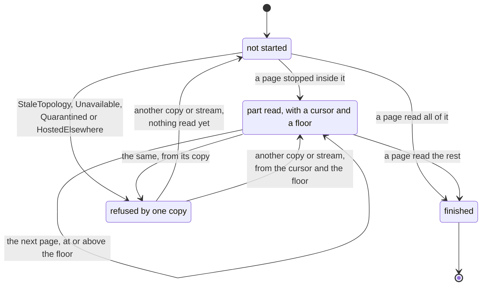
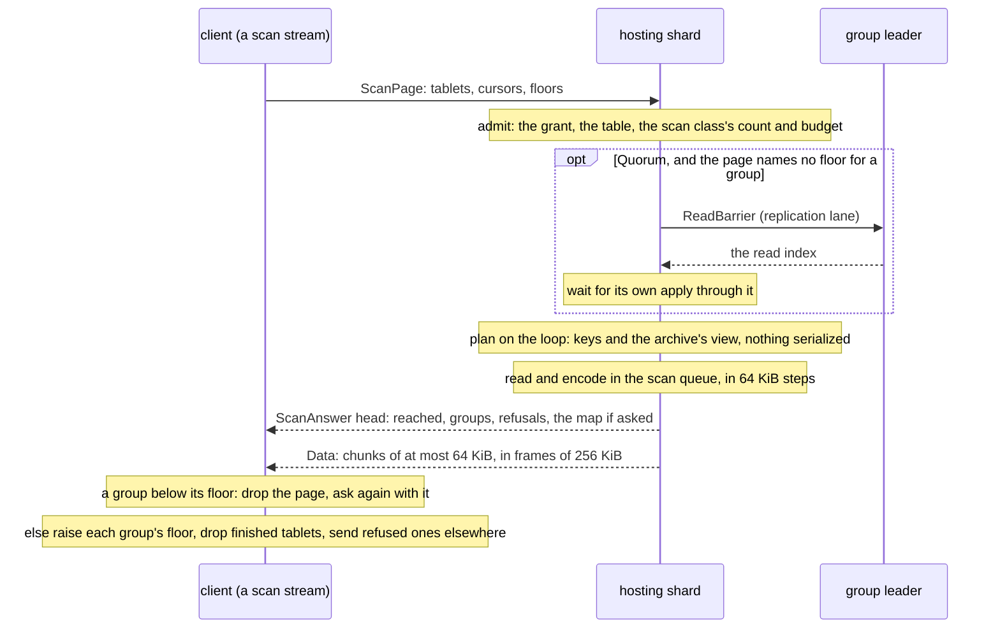

# W4. The cursor, the page and the wire

## Context

A scan is read a page at a time, and a page has to be something a client can ask for again: from
another copy, after a failure, after a restart of the client itself. This page says what one page
is, what a cursor holds so the next page starts where the last ended, and how both cross the client
wire. It leans on [W2](ordering.md) for the order a cursor is a position in and on
[W13](contract.md#the-contract) for what a page promises.

## What exists today

- **The walk's page, for drivers.** A `WalkAsk` names a table, a tablet, a range of its keys, the
  last key handed out (`after`), bounds of partitions and bytes, and `at_least`, the highest boundary
  any earlier page was read at; a `WalkPage` carries the partitions, the boundary, whether the copy
  led and the next cursor (`shoal-core/src/server/shard/walk.rs:59-200`). Bounds default to 1,000
  partitions and 1 MiB and stop at 10,000 and 64 MiB, and a page always holds one partition
  ([F87](../../features/tablet-walk.md#a-page-is-captured-on-the-loop-and-read-off-it)). A client reaches
  it only as the admin read `walk`, which answers keys and counts in JSON, never rows.
- **One query index, one response.** The client's reorder buffer is keyed by a query's index and
  overwrites on a second answer, so "anything that makes a query answer twice breaks the reorder
  buffer, not just the caller's row count" (`docs/src/api/client.md:375-386`). A page of a scan is
  the second answer of a query by construction.
- **Frames of their own, beside a bundle.** [F80](../../features/object-wire.md) put object operations
  on two message types with fixed little-endian heads, `ObjectOp` (28, a 56 byte head) and
  `ObjectAnswer` (29, 80 bytes), behind `CLIENT_CAP_OBJECTS`, bit 4 of the hello's capability byte,
  their bytes in [F73](../../features/bodies-across-frames.md)'s `Data` frames
  (`shoal-proto/src/shared/protocol.rs:381-400`, `shoal-proto/src/shared/protocol/object.rs:54-67`).
  Bits 0 to 4 are spent and 5 to 7 free, and **no reserved byte is left in a hello**: anything a hello
  cannot hold needs a new protocol version (`shoal-proto/src/shared/protocol/handshake.rs:15-30`). A
  cluster turns a new frame on with `activate N` once every member's build can read it
  ([F48](../../features/rolling-compatibility.md)); the protocol version is ~~16
  (`shoal-proto/src/shared/protocol.rs:183`)~~ 17 since [Resolved #336](../../appendix/resolved/restore-drives-fenced.md)
  (`shoal-proto/src/shared/protocol.rs:190`), so the next free wire version is 18. Message types 1 to 31
  are spent and 32 up are free; header flag bits 9 to 15 are free (`protocol.rs:318-465`, `:529-581`).
- **`Cancel`** names a bundle's id on the connection that sent it and is answered once
  ([F75](../../features/client-cancel.md)).
- **A get's filter and projection are types of its table, not numbers.** `UnsortedGet` and `SortedGet`
  carry `filters: Option<R::Filters>`, a struct of one `Option<Vec<T>>` a filterable field, and
  `projection: R::Projection`, an enum whose first variant is `Full`
  (`shoal-proto/src/shared/queries/unsorted.rs:145-154`, `shoal-derive/src/projections.rs:27-58`). No
  projection has an id on the wire.
- **A client cannot name a group.** A group's identity is the hash of its table and of the replica set
  the rule first derived, and a move keeps it over other members (`GroupId::of`,
  `shoal-proto/src/shared/identity.rs:263-298`; `shoal-core/src/server/map.rs:104-115`). A client's
  route table knows each tablet's replicas by node and slot (`ShardAddr`, `routes.rs:49-68`), so it can
  tell which tablets share a set today but not which group they are; the fixture's `SCAN` learns a
  tablet's group from its first page (`shoal/tests/cluster_fixture.rs:2026-2040`). A shard's tablets of
  one table belong to about as many groups as there are copies.
- **A page's ~~draw~~ admission draws at most 4 MiB** (`SCAN_MAX_BYTES`, `shoal-proto/src/shared/protocol/admin.rs:509`),
  and its reads draw past it, ~~every archived record twice, its read and its merge's copy~~ every archived
  record once, the heap buffer its read fills, since [F134](../../features/walked-records-uncopied.md) hands a
  record out where its read put it, and copy room only for the pieces a fold over fragments makes; a page that
  needs more than the whole scan budget is refused `ResponseTooLarge`
  (`shoal-core/src/server/shard/walk.rs:548-566`), ~~by each draw alone~~ counting everything it would
  hold, by its partition's key, once it has covered no key
  ([Resolved #370](../../appendix/resolved/scan-partition-past-its-budget.md)). Nothing draws for a page's answer while it waits to
  be written: its permits go back when the page is dropped (`walk.rs:287-289`).
- **The body in partitions is built** since [F132](../../features/whole-partitions-in-answers.md)
  (2026-11-06), below the frames: the engine's partitions archive as `shoal-proto`'s layouts
  (`shoal-proto/src/shared/partitions.rs`), `PARTITION_LAYOUT` names them, a chunk's head is
  `ChunkHead`, the shard writes a page's partitions as a body with `WalkPage::partition_body`, which holds
  the page's draw until it is dropped, and the client reads one with `PartitionPage::read`
  (`shoal-proto/src/shared/protocol/scan.rs`). Nothing carries a body yet: the frames are M24's.

## The design

### What one page is

**A page is one request and one answer, to one shard, over some of that shard's tablets.** The
request names the tablets of one hosting shard that are still to be read, and a cursor for each it
left part way. The shard reads them in ascending order, each from its cursor or its start, until a
bound is met, and answers with the rows and with how far it got. A page never crosses shards and
never forwards: a tablet the node holds no copy of is refused by name, and the client sends it
elsewhere ([W6](distribution.md)).

**A page goes to the shard that hosts its lowest tablet, and names no shard.** A connection lands on
whichever shard accepted it, and that shard hands the page to the executor hosting the lowest of its
tablets the node holds a copy of (`Ring::owner`, `Hosting::owner_of_tablet`). A requested tablet that
another shard of the node hosts is refused `HostedElsewhere`, and the client asks the node for it in a
stream of its own. A client of a cluster groups its tablets by node and slot from its route table, so
its pages meet the refusal only when its map is stale. A client of a standalone node knows no
executor: its first page asks every tablet, the shard of tablet 0 reads its own and refuses the rest,
the next page asks those, and so on, so a node of `E` executors has a stream for each after `E` pages,
each tablet read by one of them. ✅ Settled with the frames below by
[Q36](contract.md#q36-the-cursor-and-the-frames-2026-11-06) (2026-11-06).

That shape answers three things at once. An empty tablet costs nothing but a counter's read, since
the archive map counts each tablet's partitions (`TabletUsage`,
`shoal-core/src/server/tables/storage/fs/map.rs:512-522`) and a table's resident partitions are held
in a map a tablet (`shoal-core/src/server/tables/resident.rs:31-49`, its length the count), so a scan
of an empty table is one page a hosting shard, about nine on three nodes of three slots,
not 4096. [X19](the-edges.md) confirmed it (2026-11-07) for a table never written and an unsorted table whose
deletes were compacted, whose counters were zero, 4096 tablets at a page each costing about 12.5 ms of four shards;
a sparse table's empty tablets read 14.1 MiB of index pages a scan without the skip. It is not so for a sorted
table emptied by deletes, whose tablets the counters call held, with dead chains a scan reads until a merge
rewrites them (8,192 records, 1.9 s), nor for deletes a start has not compacted yet. A sparse table fills a page from as many tablets as it takes, so nothing has to grow a
concurrency when pages come back thin, which is what ScyllaDB's coordinator does round by round
([W3](prior-art.md#scylladb)). And a page is one copy's, so what it promises is one copy's.

**A page's progress is one key.** A tablet is the top twelve bits of its keys
(`shoal-proto/src/shared/placement.rs:19-58`), so tablets read in ascending order hand their keys out
in ascending order across the whole page, and how far a page got is one key, `reached`: the last key
it covered, which may be a key it read past without handing out, as the walk's `next` already is
(`shoal-core/src/server/tables/walk.rs:1089-1091`). Every requested tablet below `reached`'s tablet
that was not refused is finished, and so is `reached`'s own when `reached` is its last key; the rest
keep their cursors. A filtered page that matched nothing still moves `reached`. No answer carries a
bitmap of what it finished.

### The request: `ScanPage`

Message type 32, client to server, sent only on a connection granted `CLIENT_CAP_SCANS`: a fixed
little-endian head of 96 bytes, then its sections, which fill the frame exactly. ~~Every field below is
a proposal for [M24](milestones.md#m24-scans-on-one-node) to fix; none is on a wire yet.~~ Fixed by
[Q36](contract.md#q36-the-cursor-and-the-frames-2026-11-06) (2026-11-06), for M24 to build as written;
none is on a wire yet. The bounds' defaults and caps are M24's to confirm, and moving one moves no
byte.

| Bytes | Field | Holds |
| --- | --- | --- |
| 0..16 | Page | A v7 UUID, fresh for every ask, which the answer comes under and `Cancel` names |
| 16..32 | Scan | A v7 UUID, the same on every page of a scan and in its token: a scan's followers are spread by it ([W6](distribution.md#choosing-copies)), and a later saved reader would be keyed by it ([W5](tablet-reader.md#saved-positions-optional)) |
| 32..40 | Target | The table's `TableId`, or a listing's `BucketId` ([W9](bucket-listing.md)) |
| 40..48 | Fingerprint | The table's own (`table_fingerprint_of`), or the bucket's; one that is not the node's is refused `WrongFingerprint` |
| 48..56 | Layout | The `PARTITION_LAYOUT` the client reads, when it asks for partitions, and zero otherwise; a layout the node does not write is refused `UnknownLayout` before anything is read |
| 56 | Target kind | 1 a table, 2 a bucket's listing, refused by name before [M26](milestones.md#m26-listing-a-buckets-objects) |
| 57 | Level | `ReadLevel::from_byte`: 0 the table's policy, 1 `One`, 2 `Quorum` ([C6](../../distributed/reads.md)). Since [Q38](contract.md#q38-which-copies-a-scan-reads-and-its-levels-2026-11-14) the client resolves the policy once, at the scan's start, and sends 1 or 2 on every page; a node resolves a 0 from its committed policy, as it resolves a get's |
| 58 | Body | 0 rows, 1 partitions ([below](#the-body-rows-or-partitions-on-request)) |
| 59 | Tablet bits | `TABLET_BITS`, 12. A node whose tablets are cut otherwise refuses the page by name, so a later split of tablets is a value here and not a frame; since F140 such a page is read no further than its head, since the bitmap's length follows the bits |
| 60..62 | Flags | Bit 0 `GROUPS`: answer with each requested tablet's group ([below](#which-group-a-tablet-is-in)). Every other bit zero |
| 62..64 | Cursors | How many, at most 64 |
| 64..66 | Floors | How many, at most 255 |
| 66..68 | Reserved | Zero |
| 68..72 | Rows | Rows the page may hand out: 1,000 when zero, 10,000 at most |
| 72..76 | Answer bytes | 1 MiB when zero, 4 MiB at most, a page's whole draw (`SCAN_MAX_BYTES`) |
| 76..80 | Work | Bytes the page may read, so a filter that matches little cannot read a whole tablet inside one page: 4 MiB when zero, ~~64 MiB~~ 4 MiB at most since [X19](the-edges.md) (2026-11-07, with the user), since a page that keeps nothing draws about its work from the scan budget and a larger bound bought no speed |
| 80..84 | Deadline | Milliseconds the page may take on its shard, the server's when zero; the page ends short at it with what it covered |
| 84..88 | Spec length | The scan spec's bytes, at most 64 KiB |
| 88..96 | Reserved | Zero |

Then, in this order, each length known from the head before any section is read:

| Section | Bytes | Holds |
| --- | --- | --- |
| Tablets | 2bits / 8, 512 | A bitmap of the tablets the page may read, at least one |
| Cursors | 16 each | A key (8), its position's length (2), its flags (2) and four reserved bytes: the last key covered in a tablet the scan left part way, ascending, at most one a tablet, each in a requested tablet. The position's length and the flags are zero at M24 ([the cursor](#the-cursor-and-the-resume-token)) |
| Floors | 16 each | A group (8) and the highest boundary the scan has seen in it (8), each group once, ascending by group since F140, which is how once is held. Since Q38 a caller's session token is a floor too, its group and index, before any page has read the group |
| Positions | The cursors' positions' lengths, padded to 16 | ~~Empty at M24~~ Each cursor's position, one after another, since X19: the last sort key handed out of the partition at the cursor's key, in its table's archived form, at most 1,024 bytes (`SCAN_MAX_POSITION_BYTES`); a page never stops after a row whose sort key encodes past that |
| Spec | Spec length, at an offset of the body that is a multiple of 16 | The table's archived `{Table}Scan`: its `R::Filters` and its `R::Projection`, the shapes a get carries ([Query Execution](../../tables/query-execution.md)), validated with bytecheck as that table's type in a buffer aligned to 16. The derive generates it ([W10](api.md#the-client)), so its layout moves with `CLIENT_WIRE_VERSION`, as a get's does |

A request is at most ~~about 70 KiB (96 + 512 + 64 × 16 + 255 × 16 + 64 KiB)~~ about 134 KiB since
[F140](../../features/scan-frames.md) built the frames with their positions filled (96 + 512 + 64 × 16 +
255 × 16 + 64 positions of at most 1,024 bytes + 64 KiB), and a server checks a
page's frame against that, `MAX_SCAN_PAGE_FRAME`, before it reads it, as it checks an object
operation's against `MAX_OBJECT_FRAME` (`shoal-core/src/server/shard.rs:1095-1096`).

### The answer: `ScanAnswer`

Message type 33, server to client: after its header, the 16 byte page id (`server_preamble`, as an
object answer's), then a fixed little-endian head of 80 bytes and its sections. The body, when there is
one, follows in [F73](../../features/bodies-across-frames.md)'s `Data` frames under the page id, and the
answer carries `STREAMED` exactly when the body's length is not zero.

| Bytes | Field | Holds |
| --- | --- | --- |
| 0 | Ended | Why: 1 rows, 2 answer bytes, 3 work, 4 the end of its tablets, 5 its deadline or a wait for its device ([F128](../../features/device-time-pace.md)), 6 the scan budget, part way |
| 1 | Body | The request's |
| 2 | Tablet bits | The node's |
| 3 | Flags | Bit 0 `REACHED`: `reached` names a key, which every answer that covered anything sets; bit 1 `MAP`: the map section is there. Every other bit zero |
| 4..6 | Groups | How many, at most 255 |
| 6..8 | Refusals | How many, at most the requested tablets |
| 8..10 | Map | The requested tablets' count with `MAP`, zero without |
| 10..12 | Position length | `reached`'s position, zero at M24 |
| 12..16 | Chunks | How many the body holds |
| 16..24 | Reached | The last key the page covered ([above](#what-one-page-is)) |
| 24..32 | Layout | `PARTITION_LAYOUT` for partitions, zero for rows |
| 32..40 | Body length | The chunks' bytes, their heads and padding included: the length the opener declares |
| 40..44 | Partitions out | Handed out |
| 44..48 | Rows out | Handed out |
| 48..52 | Partitions read | Including those the filter left nothing of |
| 52..56 | Rows read | Before the filter |
| 56..64 | From memory | Bytes read from resident partitions |
| 64..72 | From archives | Bytes read from archive files |
| 72..76 | On the shard | Microseconds from its admission to its answer |
| 76..80 | Reserved | Zero |

Then, in this order:

| Section | Bytes | Holds |
| --- | --- | --- |
| Groups | 16 each | A group (8) and its boundary (8): the copy's applied index ~~at the page's first capture of the group~~ at the page's admission once its waits are done (M25's plan, 2026-11-15), which every capture of it in the page is at or past. Empty on a standalone node, which has no groups |
| Refusals | 4 each | A requested tablet (2) and its code (2), ascending: `StaleTopology`, `Unavailable`, `Quarantined` or `HostedElsewhere` |
| Map | 1 each, padded to 8 | With `MAP`, each requested tablet's group as its index in the groups section, ascending by tablet, or 255 for a tablet refused |
| Position | Position length | ~~Empty at M24~~ Since X19, how far into the partition at `reached` the page got when it handed that partition out part way: the last sort key handed out, at most 1,024 bytes |

An answer that did not set `REACHED` covered nothing: every tablet it was asked was refused, or its
deadline came first, and the client asks again as it did. An answer's head and sections are ~~under
25 KiB~~ under 27 KiB with every section full and a position (F140).

#### A chunk

The body is a run of chunks, each a 32 byte head and an rkyv root, its bytes padded to 16. The body is
read into a buffer aligned to 16, so every root starts at an offset a multiple of 16 and is validated
where it lies, never copied first.

| Bytes | Field | Holds |
| --- | --- | --- |
| 0..4 | Length | The root's bytes, its padding apart: ~~at most 64 KiB unless the chunk holds one row~~ in an answer in rows ~~at most 64 KiB unless the chunk holds one row~~ about 64 KiB, filled by what its rows hold where they lie, since a chunk's size is known only once it is made ([F143](../../features/scan-rows.md)), and held by a client to its body alone; in one in partitions bounded by its body alone, since the walk hands an archived partition out whole and cuts a piece at a step's 64 KiB in memory and a row past it ([F132](../../features/whole-partitions-in-answers.md#design-choices)) |
| 4..8 | Rows | The rows in it |
| 8 | Kind | 1 rows (`GetRows
`), 2 a whole partition, 3 a piece of a sorted partition; rows only in an answer in rows, the others only in one in partitions |
| 9 | Flags | Bit 0 `THROUGH`: a partition's last row is in this chunk; bit 1 `MORE`: a piece with more of its partition after it. Every other bit zero |
| 10..16 | Reserved | Zero |
| 16..24 | Through | With `THROUGH`, the last key whose rows end in this chunk: ascending chunk by chunk, never past `reached` |
| 24..32 | Reserved | Zero: where a sort position would go, should a piece of a split partition ever be handed on alone |

`Through` is what handing rows on as each chunk arrives needs ([below](#alternatives-rejected)): a
stream cut after a chunk could ask again from it. M24 hands a page's rows on only once its answer is
whole and validated ([Q35](contract.md#q35-what-a-scans-answer-carries-2026-11-06)), so it reads the
field and hands nothing on by it.

**A body's `Data` frames are at most 256 KiB** (`SCAN_DATA_FRAME_BYTES`), under kTLS or not: one rule,
so the kernel's encryption of a frame holds a core a quarter of a millisecond, and the outbox can turn
to another stream's frame between a page's ([W7](isolation.md#network)).

#### Refusals and malformed frames

As built ([F144](../../features/scan-pages-on-the-wire.md)), in this order: a listing or other tablet
bits (`InvalidRequest`), a table the schema does not have (`UnknownOperation`), a bucket's generated
table (`GeneratedTable`), then those below, a spec that is not its table's (`InvalidRequest`, by name
and not by ending the connection), and one more page than a connection may have in flight, eight
(`Shedding`). A page under an id its connection has in flight is told `InvalidRequest` and its
connection ended.

A request the shard refuses whole is answered by one `Error` frame under the page id, as an object
operation is, its code by name: a scan not granted (`Unauthorized`), a table not committed
(`UncommittedTable`), a fingerprint that is not the table's (`WrongFingerprint`, 59), a layout the node
does not write (`UnknownLayout`, 75), other tablet bits, partitions with a filter or a projection, a
bound past its most (`InvalidRequest`), a page past the scan class's count or its draw (`Shedding`), a
partition whose answer cannot fit the page's whole draw (`ResponseTooLarge`, naming its key). A tablet
the page will not read is a refusal in its answer, never an `Error` frame, so the rest of the page is
read.

**A frame that cannot be right ends its connection**, on either side, as F80's do
([F80](../../features/object-wire.md)): a count past its cap, sections that do not fill the frame, a
reserved byte or bit set, a bitmap bit past the table's tablets, a cursor outside the requested tablets
or out of order, a position before a build reads positions, a page id not v7 or already in flight on
the connection. A client checks an answer against the request it sent before it allocates anything: its
declared body against the page's answer bytes, or the page's whole draw when the body holds one
partition; its counts; `reached` inside its tablets and at or past its cursors; each refused tablet one
it asked; each chunk's length inside the body and its kind's bound; `through` ascending and never past
`reached`. Then every chunk is validated with bytecheck before any row of it is read. An answer that
fails any of these hands out no row of its page and ends the scan by name, and its token resumes it.

[X17](page-rebuilt.md#rows-encoded-on-the-shard-against-walked-partitions) priced the body
(2026-10-30): rows taken out of their archived partitions and encoded into chunks of 64 KiB cost the
shard 1.3 to 2.9 times what decoding the partitions as they lie costs a client, the most for small
rows. So an unfiltered scan's opt-in to partitions as they lie, which
[W11](tradeoffs.md) weighs against a server layout on the wire, moves forward to M24
([Q35](contract.md#questions-to-answer)). Q35 is settled since 2026-11-06, with the user
([the record](contract.md#q35-what-a-scans-answer-carries-2026-11-06)): rows by default, and partitions
for a scan that asks, as the next section has it.

### The body: rows, or partitions on request

**Rows, by default.** Every scan is answered in rows encoded on the shard: its filter applied, then
its projection, where the rows are, and never a deleted row. Rows go in F27's shape, `GetRows
`, the
rows and the groups of the partitions they came from, as rkyv chunks of at most 64 KiB and one row.
Each chunk is a root of its own, aligned to 16, and drawn from the scan budget before it is allocated.
A resident row is written from the partition holding it (`RowRef`) and an archived one field by field
from its archive (`Rearchive`), exactly as a get's are, so a scan adds no encoder of its own.

**Partitions, when an unfiltered, unprojected scan asks** (`.partitions()`, a body kind in
`ScanPage`). The answer carries the walk's partitions as the walk hands them out: the table's archived
partition each, aligned to 16, holding no tombstone, a sorted one in the pieces ~~of at most 64 KiB and a
row~~ that its fold makes ([F127](../../features/folds-in-steps.md)), each ended at a step's 64 KiB in memory
and a row past it, or whole when it needed no fold, an archived one as it lies, ~~however large~~
a record at most `max_record_bytes` since [F133](../../features/bounded-records.md), a partition past it
in a piece a record ([F132](../../features/whole-partitions-in-answers.md#design-choices)). The walk has already validated
each on the shard, so the shard pays nothing past its walk. The client validates each piece and hands
the caller the same rows a scan in rows would, paying the decode instead: 259 to 298 ns a row for
`Big` against 39 to 80 in rows, by X17. A request for partitions with a filter or a projection, of a
listing, or of a generated table is refused whole, by name.

**The layout has a version of its own.** No fingerprint covers a partition's container, and none can
start to without moving every table's. So an answer in partitions names `PARTITION_LAYOUT`, a version
moved by hand and held by a golden test of canonical partitions' archived bytes, as `OBJECT_ROWS_LAYOUT`
is for a bucket's rows. A client reads the layout through types of `shoal-proto`, never the engine's;
one that does not know a layout refuses it by name, reads none of it, and may ask again in rows. Since
[Q36](contract.md#q36-the-cursor-and-the-frames-2026-11-06) a request for partitions names the layout
its client reads, so a node that writes another refuses the page `UnknownLayout` before it reads
anything, and the answer names its layout again for the client to check.

**Nothing is read before it is validated, and nothing is handed on before its page is whole.** The
client checks a chunk's declared length against the page's answer bytes and its kind's bound before it
allocates, validates the chunk with bytecheck in a buffer aligned to 16, and hands the page's rows on
only once every chunk of it has validated. A shard sends a page only once the page is read and its copy
checked, and a stream's cursor moves only at the page's end. So a page whose connection was cut is
asked again from where it began, and hands out nothing twice. A chunk that does not validate hands out
no row of its page and ends the scan by name, which its token resumes.

| | Rows | Partitions |
| --- | --- | --- |
| Asked for | By default | `.partitions()`, an unfiltered, unprojected scan of a table |
| Filter and projection | Applied on the shard | Refused |
| The shard's cost past its walk | 80 to 280 ns a row at most (X17), less through `Rearchive` and a projection | None |
| The client's cost a row (X17) | 29 to 80 ns | 68 to 298 ns |
| On the wire | `GetRows
`, the projection's fields | Every field, and the partition's own: its key, its size and a sorted one's `check_disk` |
| Its layout | The row's, which the table's fingerprint covers | `PARTITION_LAYOUT`'s, pinned by a golden test |

### Bounds, and short pages

A page ends at the first of its bounds: rows handed out (1,000 unless asked, S3's page and F87's
default), answer bytes (1 MiB), work (4 MiB of bytes read unless asked), the end of its tablets, or
~~a slice of the shard's time~~ its deadline or a wait for its device, and the answer says which. **A
short page is normal**, and so is an empty one: a filter that
matched nothing in 4 MiB of reading ends its page with no rows and a cursor that moved. **The end of a
scan is a flag, never a count**: the client stops when every tablet is finished, never when a page
is short. ScyllaDB's drivers learned that one the hard way, a driver that stopped at an empty page of
a filtered scan was a bug ([W3](prior-art.md#scylladb)).

A page always makes progress: it holds at least one partition, as the walk's does, or it moved its
cursor past what it read; only a page whose every tablet was refused, or whose deadline came before it
covered a key, moves nothing, and is asked again. A sorted partition larger than the page is still one
page at first, read whole, which is the walk's limit too: its answer passes the page's answer bytes by
that one partition, up to ~~the page's whole draw of 4 MiB~~ what the node's scan budget holds of it
beside its read, about half the budget, 4 MiB on a node of one shard and 16 MiB on one of four
([Resolved #370](../../appendix/resolved/scan-partition-past-its-budget.md)). ~~the cursor's reserved suffix~~ The cursor's
reserved position is where splitting one would land ([below](#the-cursor-and-the-resume-token)). ~~Until
then a sorted partition whose answer cannot fit that draw the budget cannot hold is refused `ResponseTooLarge` by its key, and
ends its scan by name; whether M24 splits it instead is X19's to decide.~~ **Since [X19](the-edges.md)
(2026-11-07, with the user) M24 splits it, and refuses no partition for its size**: no partition may fail
or go missing from a scan. A large sorted partition is written as records of bounded size, a page reads and
hands it out a record at a time and ends at its bounds, and its cursor's position says how far in it got. A
row that cannot be split is handed out from its read buffer, never copied, under a scan budget of at least
the largest row the node admits, so it fits alone and waits its turn for room. **The split is built**
(2026-11-10, [F142](../../features/split-partitions.md)): a page that may cut ends before a partition that
does not fit what it has left, so its answer bytes are passed by a record at most, and a sorted partition
that fits no page is cut after a record of its archive or a piece of it in memory. Rows stay a bound that
is met, never cut to. Both of what it stands on are built:
[F134](../../features/walked-records-uncopied.md) hands a record out uncopied, and
[F135](../../features/scan-budget-floor.md) keeps the budget at least the node's request body bound and a row's
slack, its waiting draws served in turn.

### The cursor and the resume token

**A tablet's cursor is the last key ~~handed out~~ covered in it**, and its next page starts past it:
F87's cursor, F1's too. A page can read past keys it does not hand out, a filter's or a run with no
live row, and its cursor moves past them. **A cursor is a key and nothing else**: its tablet is the
key's top bits, so a cursor stays a position through a split of its tablet ([W2](ordering.md#invariants-to-uphold)).
A request carries a cursor for each of its tablets left part way, up to 64. A stream holds its own open
tablet, and a tablet left part way on a copy that then refused it joins another stream with its cursor
([W6](distribution.md#when-a-page-is-refused)), so a request can hold more than one; a driver holding
more than 64 splits them over requests.

**Each cursor reserves a sort-key position**: a length and flags beside the key, zero at M24, and a
positions section a request and an answer carry, empty at M24. A position is what a key cannot say
alone. A cursor with one would mean the partition at its key was handed out part way, up to the sort key
the position holds; an ordered scan, a target kind of its own at M27, would carry its last encoding there
and its progress in the answer's `reached` position ([W8](declared-order.md#an-ordered-scan)). That is
where splitting one sorted partition across pages lands without a new frame, should [X19](spikes.md#x19-the-edges)
find that M24 needs it, decided with the user on 2026-11-06; it would also restate
[P20](contract.md#the-contract) for a partition handed out in pieces at more than one boundary. ~~Until a
build reads positions, one is a frame that cannot be right.~~ **X19 found M24 needs it** (2026-11-07, with the
user, [the record](contract.md#x19-measured-the-edges-decided-with-the-user-2026-11-07)): M24 fills the
position and P20 is restated, each of a split partition's live rows once. ~~Until a build reads positions, one is
a frame that cannot be right.~~ Since [F142](../../features/split-partitions.md) a node reads them: a position
is the last sort key handed out, in its table's archived form, behind sixteen bytes the node keeps for itself (a
version, a hint of the record after that key, and a stamp of the archive the hint was taken from). It is the
node's to read and a client's only to carry; one a node did not write is refused `InvalidRequest`.

**A group's floor is the highest boundary any page of the scan was read at in that group**:
a page asked of any copy of the group says `at_least` that index, and a copy behind it refuses by
name rather than hand out an older state ([F87](../../features/tablet-walk.md#a-walk-keeps-a-cursor-and-a-floor)).
Floors are kept a group, not a tablet: a group's tablets share one log, and a group's identity
survives a move of its replica set ([C8](../../distributed/rebalancing.md)). A request carries the
floors of its tablets' groups, at most 255, and a shard applies each only to the tablets of that group
on its copy, setting aside a floor of a group none of them is in. **At `Quorum`, a group the page names
no floor for takes the barrier** ([W6](distribution.md#floors-and-barriers)), and its boundary becomes
the floor; ~~a bit asking for a barrier~~ no bit asks for one.

Since [Q38](contract.md#q38-which-copies-a-scan-reads-and-its-levels-2026-11-14) (2026-11-14, by design):

- **A copy behind a floor waits briefly**, for its apply to reach it, at most 250 ms (`FLOOR_WAIT`) on
  the page's task, then refuses the group's tablets `Unavailable` ~~with its applied index~~ (since M25's
  plan, 2026-11-15, the index is counted and logged: a refusal has no field for it,
  [the amendments](contract.md#amended-at-m25s-plan-2026-11-15)); a copy a full disk froze, or whose log does
  not reach the floor, refuses at once.
- **A group's barrier is a get's** (`read_barrier`): taken through the copy's own handle when it leads,
  through `ReplicateKind::ReadBarrier` when it follows, the page's groups' barriers together, and the
  copy's apply waited for through it within the page's deadline. One that cannot be taken refuses the
  group's tablets `Unavailable`.
- **A copy that is not a voter refuses the page's tablets of its group `Unavailable`**: its map's spec
  marks it a learner, or its membership as last applied names no voter of its node.
- **A caller's session token is a floor the request carries from the scan's first page**, so the first
  page of its group reads at or above its index and, at `Quorum`, still takes the group's barrier.

#### Which group a tablet is in

No client can work out a group's identity ([above](#what-exists-today)), so it learns each tablet's
from the answers. A request sets `GROUPS` while the group of any of its tablets is unknown to the
client, and the answer's map names the group of every tablet it was asked; after a stream's first page
the client knows its tablets' groups, and sends their floors. A page can still be read below a floor
the client holds: on a tablet whose group it had not learned, asked of another copy before any answer
named it. So **the client drops a page whole, before any of its rows is handed on, when any group's
boundary in it is below the floor it ~~holds~~ held for that group when it asked the page**, and asks again
with that floor. Judged at the answer instead, two streams of one group under writes would drop each other's
pages for ever (M25's plan). A group's boundary is its copy's applied index at the page's admission, once its
waits are done, so a group whose tablets the page found empty is named too. The page
was never handed on, so nothing is handed out twice, and every page of the group it hands on was read
at or above its floor, which is [P21](contract.md#the-contract). A standalone node has no groups: its
answers name none, and its requests carry no floors.

#### The resume token

What a client keeps of a scan, and can write down and hand back later, is its **resume token**, bytes
the caller owns:

| Bytes | Field | Holds |
| --- | --- | --- |
| 0..4 | Magic | `SHSC` |
| 4 | Version | 1 |
| 5 | Target kind | The request's |
| 6 | Level | The request's |
| 7 | Body | The request's |
| 8 | Tablet bits | 12 |
| 9 | Flags | Zero |
| 10..12 | Cursors | How many |
| 12..14 | Floors | How many |
| 14..16 | Reserved | Zero |
| 16..32 | Scan | The scan's id |
| 32..48 | Cluster | The `ClusterId` the client's route table names (`routes.rs:52-53`), nil for a standalone node |
| 48..56 | Target | The table's or the bucket's id |
| 56..64 | Fingerprint | The table's or the bucket's |
| 64..72 | Spec digest | CRC-64/NVME of the archived spec: the filter and projection the scan was started with |
| 72..80 | Layout | The request's |
| 80..592 | Unfinished | A bitmap of the tablets not finished |
| Then | Cursors, floors, positions | As a request carries them: 16 bytes a cursor, 16 a floor |
| Last 8 | Check | CRC-64/NVME of every byte before it |

~~Under a kibibyte for any scan.~~ 600 bytes, and 16 more for each group the scan read and each tablet
it left part way: about a kibibyte for a scan of the lab's tables, nine groups and a cursor for each of
eighteen streams, and about 20 KiB for a table over fifty nodes of twenty-four slots, which reads 1,200
groups. `resume` refuses a token by name before any page is sent: of another cluster, another
fingerprint (another schema's table or another table's), another spec than the scan it is handed,
another version, or bytes whose check fails. A token from before a move, a failover or a restart
resumes, because nothing in it names a place.

**A token is not signed.** Everything in it is what a `ScanPage` could ask anyway, and a node checks
the grant, the table, its fingerprint and every bound on every page, whether its client started the
scan or resumed it. A floor raised by hand only refuses its own scan's pages (`Unavailable`, every copy
behind it), and the driver ends that scan by name once a tablet has been refused by every copy past its
patience ([W6](distribution.md#when-a-page-is-refused)); a cursor moved by hand skips its own scan's
keys. The check is for a token damaged where it was kept, not for one forged.

### A page on the wire

### Pull, one page in flight

A stream has one page in flight: its next page depends on where the last one ended. A client runs
several streams at once, one or two a hosting shard ([W6](distribution.md#streams)). A request is
idempotent: asked again of the same copy or another, it is answered by a page at or after its floor,
which is all [P21](contract.md#the-contract) promises, so a client that lost an answer asks again with
the same cursors and floors, under a fresh page id.

### Capability and activation

A client asks for `CLIENT_CAP_SCANS`, bit 5 of the hello's capability byte, and a server grants it
only beside `CLIENT_CAP_STREAMS`, since an answer longer than a frame streams, ~~.~~ and since
[Q36](contract.md#q36-the-cursor-and-the-frames-2026-11-06) beside `CLIENT_CAP_CANCEL` too, so a page
its client dropped is cancelled at its next step rather than read to its end (`granted_caps`, which
grants `CLIENT_CAP_OBJECTS` only beside streams today, `shoal-core/src/server/shard.rs:415-430`). A
cluster answers a scan only once a wire version of its own is activated, the next free one,
`SCAN_WIRE_VERSION`, 18, so no member that cannot read the frames is asked to: a cluster node grants
the bit only past it, from [M25](milestones.md#m25-scans-across-a-cluster). A standalone node answers
once it grants the bit, from M24. `CLIENT_WIRE_VERSION` does not move for the frames: the bit says a
client reads them, as `CLIENT_CAP_OBJECTS` says it reads F80's, and the scan spec is a type the derive
generates, whose layout moves the client wire version as a get's does. The `scan` privilege
lands behind the same activation ([W10](api.md#grants)).

### `Cancel`

`Cancel` names a page's id, as it names a bundle's, and a client that drops a scan cancels the page
it has in flight. A page checks the node's cancel board between its steps, so a cancelled page stops
at its next step, not at its end, which goes further than F75 does for a query already running. It is
answered once, by one `Error` frame of `Cancelled` under the page id, as a bundle's cancel is, whether
or not the page's answer went first. Every ask has a fresh page id, so a cancel or a late answer of an
ask given up never meets the ask after it, and a client drops an answer whose id it has not in flight.

**A page's answer holds its draw until its last frame is written.** The scan budget bounds what a
page's buffers hold while it reads ([F118](../../features/scan-budget.md)); an answer that let its
draw go when the page was dropped and then waited in the outbox for a client that reads slowly would
hold memory no budget sees. Kept to its last frame, as a served object answer keeps its buffers and
their draw ([F106](../../features/lane-copies.md)), a slow client costs its shard at most its own
pages' bytes, and the pages beside them are shed rather than the node's memory grown.

## Alternatives rejected

**A `QueryKinds` query.** A scan answers more than once, which the client's reorder buffer cannot
take; it routes by tablet, not by key; and it needs admission and refusals a get does not have. F80
made the same choice for objects.

**One request, every page streamed, with credits.** A stream with a window would save a round trip a
page. It would also make a scan a session on one copy: a failover would lose every page in flight, a
retry would have to say which pages it had, and a server would hold state between pages, which this
plan does not. One page in flight a stream, several streams, recovers the overlap where it matters.
Sending the next cursor ahead of a page's rows, so the next request can leave before the rows are
read, is a later gain that needs no new frame ([beside the gates](milestones.md#beside-the-gates)). ✅ Priced by
[X39](cursor-sent-ahead.md) on 2026-11-15, measured, not taken: on the lab's link a stream's gap between pages is
0.15% to 0.5% of a resident scan and nothing of an archived one, and filling it cost the cell's reads 6% at the p99.

**A page for each tablet.** 4096 requests for every table, most for empty tablets. A request carries
every tablet of its shard instead.

**A cursor held by the server**, a scan session a client reconnects to. It would pin memory and a
copy for as long as a client paces itself, and a new leader or a restarted node would have to start
over. ScyllaDB keeps saved readers as a cache with a ten second life, never as the scan's state
([W3](prior-art.md#scylladb)); so would Shoal, if [X17](spikes.md#x17-a-page-rebuilt) shows one is
worth it.

**The walk's admin read for clients.** JSON, keys and counts, one tablet, an admin's grant: built
for an operator's check, and F87 says so.

**Partitions for every unfiltered scan, unasked** ([Q35](contract.md#q35-what-a-scans-answer-carries-2026-11-06)).
The shard would always do the least, and every client would pay several times its decode, 68 to 298 ns
a row against 29 to 80, whether or not it has the cores. Rejected with the user: the default costs a
Zen1 shard under 3% of a walked partition for `Big`'s rows, and a caller who would rather pay it asks.

**The partition layout mixed into every table's fingerprint.** It would pin the layout as well as a
version does, and move every table's fingerprint the day it lands: every archive, snapshot and backup
is judged by one ([F93](../../features/operations-and-the-real-cluster.md)). A version in the answer
moves nothing that exists.

**A filter or a projection applied to partitions by the client.** The client would read every row the
filter drops and every field the projection leaves out over the wire, which is what a filter and a
projection are for. A filtered or projected scan is answered in rows.

**Rows handed on as each chunk arrives.** A chunk sooner, but a page whose connection is cut part way
is asked again from where it began, so the rows of its first chunks would be handed out twice, against
[P20](contract.md#the-contract). It needs each chunk to carry the last partition it finished, and a
stream to ask again from there: a later gain ~~for Q36's frames~~, priced on M24's streams. Since
[Q36](contract.md#q36-the-cursor-and-the-frames-2026-11-06) every chunk carries it (`Through`), so the
gain needs no new frame, only a client that asks again from a chunk.

**A page's tablets named by a slot, a node or an executor.** A cluster client knows each tablet's slot,
but a standalone node's client knows none, and a frame that named one would still need the refusal for a
stale map. A cursor and a token that named a place would fail after a move, against
[P25](contract.md#the-contract). The shard that hosts a page's lowest tablet reads it, and refuses by name
the tablets another shard hosts.

**One open cursor a request**, as this page first had it. A tablet left part way on a copy that then
refused it has a cursor of its own, and the stream that takes it up has its own open tablet: one cursor
could not hold both, and the driver would have to give the moved tablet a stream of its own for one page.

**A bitmap of the tablets a page finished.** 512 bytes in every answer to say what one key says, since a
page reads its tablets in ascending order and a tablet is the top bits of its keys: everything below
`reached` that was not refused is finished.

**A bit asking for a barrier.** A floor already says whether the client has a group's boundary; a page
that names none at `Quorum` takes the barrier, which a bit could only contradict.

**Groups worked out by the client.** A group's identity is the hash of the members it started on and a
move keeps it, so a client that hashed today's members would name a group that does not exist after any
move, and two sets that came to share members would look like one. The answers name each tablet's group.

**Every floor the scan holds in every request.** Correct without the map, and 16 bytes a group the scan
has read in every page: about 20 KiB a request on a table over 1,200 groups, where a page needs the two
or three its tablets are in.

**A resume token signed with a key of the cluster's.** A token holds nothing the server trusts: every
page is checked for its grant, its table, its fingerprint and its bounds as it is asked, from a token or
not, and a token changed by hand harms only its own scan. A key would have to be shared by every node and
rotated, and it would stop a token resuming against a cluster restored from a backup, for no gain. The
token's check is against damage, and a CRC is enough for that.

**A checksum on every chunk.** A get's answer carries none: TLS, where a deployment runs it, or the
transport covers the bytes, and bytecheck covers their structure. An object's read carries one because
its bytes are what a client stored and names by its own checksum, which a scan's rows are not.

**Data frames sized as other streams are, 1 MiB.** Under kTLS one holds a Zen1 core about a millisecond
of encryption ([W7](isolation.md#network)), and a frame size that varied with the encryption would give a
page two shapes on the wire. One constant, 256 KiB, kTLS or not.

## What it costs

A request and an answer a page a stream: a request of 96 bytes, its 512 byte bitmap and 16 bytes a
cursor and a floor, and its spec; an answer of 104 bytes before its sections, 16 bytes a group, 4 a
refusal and, while the client learns its groups, a byte a tablet; 32 bytes a chunk of 64 KiB and 24 a
data frame of 256 KiB, about a thousandth of a full page. A resume token of 600 bytes and 16 a group
read and a tablet left part way. ~~under a kibibyte a scan~~ One barrier a group at `Quorum`, and one
more a stream that reads the group before the client has learned it. Nothing a server keeps between
pages. A client holds one page's answer a stream until it validates, a bound it sets itself with the
page's answer bytes; a scan in partitions moves the decode from the shard to it.

## What it breaks

Nothing that exists: two new message types, a capability bit nothing uses, three new error codes
(`HostedElsewhere` 58, `WrongFingerprint` 59, `UnknownLayout` 75), and a wire version a cluster activates
when it is ready. A client that never asks for the bit sees nothing new.

## Invariants to uphold

- **A page is one shard's**: it never crosses shards and is never forwarded.
- **A cursor names positions**: tablets, keys and group floors, never a node or an executor.
- **The end of a scan is a flag.** No client stops on a short or empty page.
- **A floor never lowers**, and every page of a group is read at or above it.
- **A request is idempotent**: the same request again gets a page at or after its floor.
- **A filter and a projection are applied on the shard or the scan is refused.** Partitions are
  answered only to an unfiltered, unprojected scan of a table, never to a listing or a generated table.
- **No byte of an answer is read before it validates**: a declared length checked before anything is
  allocated, bytecheck before any access, never unchecked.
- **A page's rows are handed on only once its answer is whole and validated**, so a page asked again
  hands out nothing twice.
- **A change to a partition's archived bytes moves `PARTITION_LAYOUT`**, which its golden test fails
  without; no table fingerprint moves for it.
- **A page's progress is one key**, `reached`, which only rises within a request's tablets: a tablet is
  the top bits of its keys, and a page reads its tablets in ascending order. A change that read them in
  another order would need a finished set on the wire again.
- **A cursor is a key**: its tablet is never written beside it, and a position is never set before a
  build reads positions and P20 says what a partition handed out in pieces promises.
- **A tablet's group comes from an answer, never from a client's map**, and a page with a group below
  the floor its client holds is never handed on.
- **No frame names a slot, a node or an executor.** A page goes to the shard of its lowest tablet, and
  a tablet another shard hosts is refused by name.
- **Every length is checked before anything is allocated**, on both sides: a frame against its most, a
  section against its count, a body against the page's bound, a chunk against the body.
- **A frame that cannot be right ends its connection**, and a request the node will not serve is
  answered by name; a client never reads on past either.
- **Every ask has a fresh page id**, and a client hands on only an answer of an ask in flight.
- **A page's answer holds its draw until its last frame is written.**
- **A scan is granted only beside streams and cancel**, and a cluster node grants it only past wire 18.
- **The heads are fixed**: a field added to one is a new message type or a flag, never a longer head.

## Prerequisites

None of [W1](prerequisites.md)'s on the wire itself; the admission class and the budget are what the
shard checks first.

## How it would be measured

What a page costs on a shard, planned, read and encoded, is [X17](spikes.md#x17-a-page-rebuilt)'s;
what an empty table and a page of empty tablets cost is [X19](spikes.md#x19-the-edges)'s, measured 2026-11-07
([its record](the-edges.md#e1-4096-empty-tablets)); the bytes
a page puts on the wire against the rows it hands out are counted in every run ([W12](performance.md)).

## Acceptance tests

| Test | Gate | Proves |
| --- | --- | --- |
| `a_page_reads_its_shards_tablets_in_order_until_a_bound` | M24 | A page covers several tablets, ends at its first bound and says which |
| `a_short_or_empty_page_never_ends_a_scan` | M24 | A filtered scan whose pages hold nothing still finishes every tablet |
| `an_empty_table_is_scanned_in_one_page_a_shard` | M24 | 4096 empty tablets cost one page a hosting shard |
| `a_resume_token_resumes_and_is_refused_for_another_table` | M24 | A token resumes where it stopped, and another fingerprint's is refused by name |
| `a_scan_is_refused_without_the_capability` | M24 | A client that did not ask for bit 5, or a server without streams or cancel, never sends or answers a page |
| `a_cancelled_page_stops_at_its_next_step` | M24 | `Cancel` of a page in flight is answered once and the page reads no further |
| `an_unfiltered_scan_in_partitions_hands_out_the_rows_a_scan_in_rows_does` | M24 | Both bodies hand the caller the same rows, of sorted partitions in pieces, resident, overlaid and archived alike. Its partitions half is built since F132, against the rows written and the walk's own decoders (`walked_partitions_read_on_the_client_as_the_rows_written`); M24 adds the rows body beside it |
| `partitions_are_refused_with_a_filter_a_projection_or_a_listing` | M24 | A request for partitions with a filter, a projection, of a listing or a generated table is refused by name and reads nothing |
| `a_partition_layout_the_client_does_not_know_is_refused_by_name` | M24 | An answer naming another `PARTITION_LAYOUT` is refused whole, no row of it read. Built since F132, against the reader (`shoal-proto`'s `protocol::scan`) |
| `the_partition_layout_is_pinned_by_its_canonical_bytes` | M24 | A change to a partition's archived bytes fails until `PARTITION_LAYOUT` moves, and the engine's partitions read as the client's. Built since F132 in `shoal-proto`, the engine's half `the_engines_partitions_archive_as_the_client_reads_them` and its bytes before the move `engine_partitions_archive_to_frozen_bytes` |
| `a_chunk_that_does_not_validate_hands_out_no_row_of_its_page` | M24 | A corrupt chunk or a length past its bound ends the scan by name before anything is allocated or handed out. The reader's half is built since F132, every check broken alone, beside `every_byte_of_a_body_flipped_never_panics`; M24 adds ending the scan |
| `a_page_cut_off_mid_answer_is_asked_again_and_hands_out_nothing_twice` | M24 | A connection cut between a page's chunks: the page is asked again and every row is handed out once |
| `the_scan_frames_heads_are_pinned_by_their_bytes` | M24 | `ScanPage`'s 96 byte head, `ScanAnswer`'s 80, a chunk's 32 and a resume token's 80 before its bitmap, each field at its offset and each section where its counts put it, pinned as F80's operation head is. A chunk's 32 are pinned since F132 (`a_chunks_head_is_pinned_by_its_bytes`) |
| `a_scan_frame_that_cannot_be_right_ends_its_connection` | M24 | A count past its cap, sections that do not fill the frame, a reserved byte or bit set, a bit past the tablets, a cursor outside its tablets or out of order, a position before a build reads them, a page id reused in flight: the connection ends and nothing is read |
| `an_answer_that_cannot_be_right_ends_its_scan_by_name` | M24 | A body past its bound, `reached` outside its tablets or behind a cursor, a refusal of a tablet not asked, `through` out of order or past `reached`: nothing allocated past the bound, no row handed on, and the scan resumable from its token |
| `a_page_covers_its_tablets_as_one_ascending_position` | M24 | A page's tablets below `reached` are finished and the rest keep their cursors, a page of a filter that matched nothing moves `reached`, and a cursor starts its tablet past its key |
| `a_tablet_another_shard_hosts_is_asked_in_a_stream_of_its_own` | M24 | A standalone node of four executors: a first page of every tablet finds each executor's tablets in four pages, and every tablet is read once |
| `a_page_ends_at_its_deadline_with_what_it_covered` | M24 | A page whose reads are held past its deadline answers what it covered, says so, and the scan goes on from it |
| `a_page_asking_a_layout_the_node_does_not_write_reads_nothing` | M24 | A request for partitions naming another `PARTITION_LAYOUT` is refused `UnknownLayout` before a read |
| `a_resume_token_that_does_not_check_is_refused_by_name` | M24 | A token whose check, version, cluster or spec digest is wrong is refused by name before any page is sent |
| `a_pages_answer_holds_its_draw_until_written` | M24 | A client that reads nothing: its page's answer stays drawn from its shard's scan budget until written, and the shard's other scan pages shed rather than its memory grow |
| `a_cluster_answers_no_scan_before_its_activation` | M25 | Below the activated version every page is refused by name |
| `a_page_below_a_known_floor_is_dropped_and_asked_again` | M25 | A tablet whose group the client had not learned, read on a copy behind the group's floor: the page is dropped whole, none of it handed out, and asked again with the floor |
| `a_scans_level_is_resolved_once_at_its_start` | M25 | Since Q38: a scan naming no level reads at its table's policy as the route table had it at its start, every page and its token carrying it, though the policy changes under it; a page naming none is read at the node's committed policy |
| `a_session_token_is_its_groups_floor` | M25 | Since Q38: a scan given a token after a write reads that write at `One` on a copy that had not applied it when the page arrived, the page waiting for it; a token of another cluster or table is refused before any page is sent |
| `a_token_of_another_lineage_ends_a_scan_by_name` | M25 | Since Q38: an answer placing a token's tablet in another group ends the scan `UnknownLineage`, none of the page handed on |

## Related

[W5](tablet-reader.md) for what a shard does with a page; [W6](distribution.md) for who asks for pages;
[F87](../../features/tablet-walk.md) for the page this generalizes; [F80](../../features/object-wire.md)
for the frames this copies; [F73](../../features/bodies-across-frames.md) and
[F75](../../features/client-cancel.md) for the streams and the cancel it rides.
