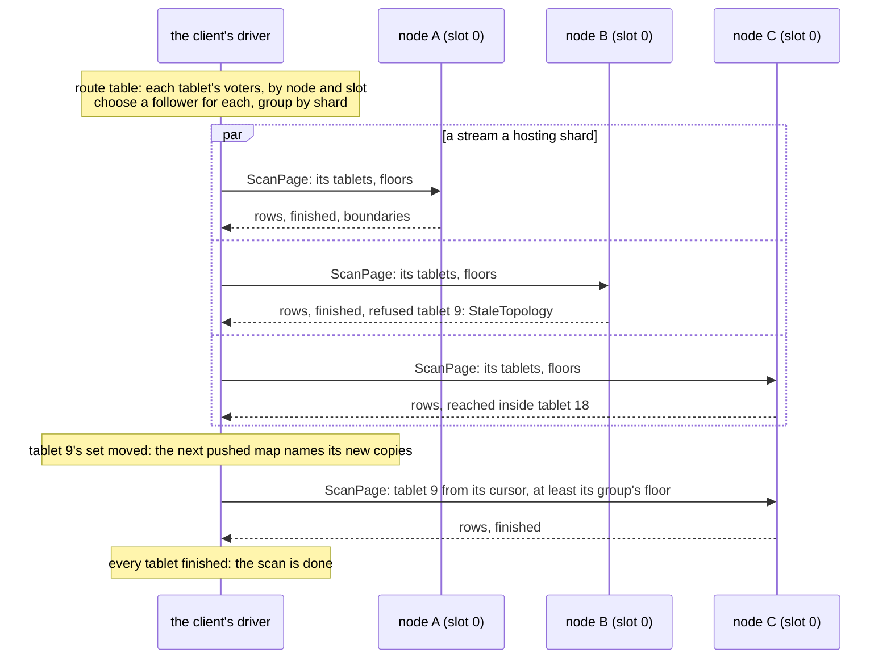
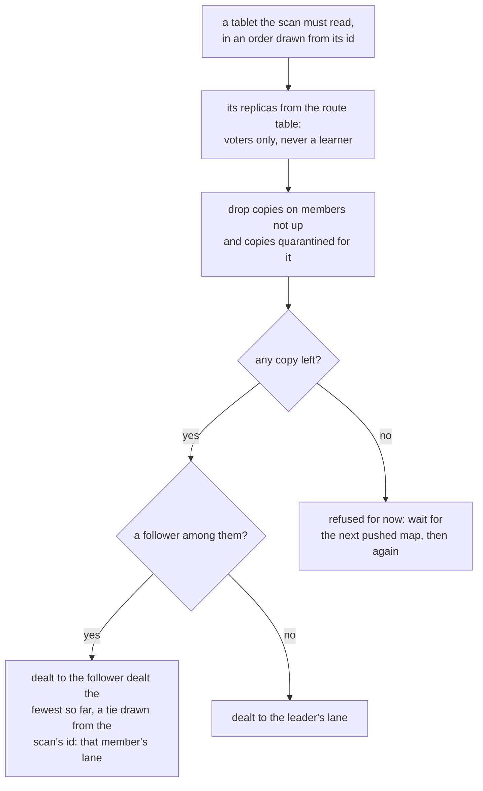
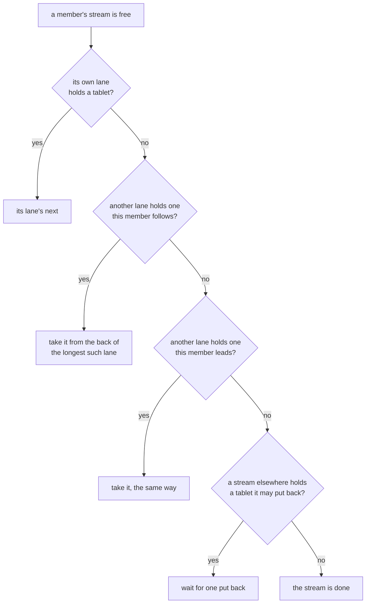

# W6. A scan across the cluster

## Context

A table's 4096 tablets are spread over every node of a cluster, each held by a replica set, each
replica on one shard of its node. A scan reads every one of them once, from one copy, in parallel,
and carries on when a copy fails, a replica set moves, a node restarts or the client itself does.
This page is who drives that, how copies are chosen, how far a page may trust a copy, and what a
refusal makes the driver do.

## What exists today

- **Placement is a rule a client can compute.** Tablet `t`'s copy `k` is on the node at
  `(t + k) % N` of the placement, on shard `(t / N) % shards` of it, the primary first
  (`rule_replicas`, `shoal-proto/src/shared/placement.rs:112-129`), and a move overrides the rule for
  its set's tablets. A group is one table on one ordered replica set, so its tablets are strided: on
  three nodes of three slots one group holds tablets 0, 9, 18 and on ([C4](../../distributed/tablet-map.md)).
  Consecutive tablets sit on different nodes.
- **A client holds the map.** Since [F74](../../features/client-routing.md) a client builds a route
  table from every pushed topology frame: each tablet's replicas as node and slot, primary first
  (`RouteTable::replicas`, `shoal-proto/src/shared/routes.rs:292`), the holders that are up and not
  quarantined (`:301`), and each table's leader for a tablet (`:341`). It sends a write and a strong
  read to the leader and a read at `One` to a holder; it never splits a query, and a get naming keys
  on several nodes goes whole to one node that gathers the rest.
- **Reads are served at two levels** ([C6](../../distributed/reads.md#two-read-levels)). `One` is a
  copy's committed, applied state, possibly stale, never an entry appended and not committed.
  `Quorum` is the same copy after a `ReadIndex` barrier from its group's leader and its own apply
  through it, so every write acknowledged before the read began is visible; a follower serves it.
- **The walk refuses a copy that is not whole by name**, `StaleTopology`, `Unavailable` or
  `Quarantined`, and admits a learner's copy (`walk_host` and `walk_copy`,
  `shoal-core/src/server/shard/walk.rs:1908-2013`, which this page cited at `:715-729` until the code
  moved). A copy behind a page's floor is refused at once, and no walk takes a read barrier: only a get
  does (`await_read_barrier`, `shoal-core/src/server/shard/reads.rs:224-352`).
- **The route table names no learner.** A tablet's replicas are a move's published configuration or the
  rule's (`RouteTable::from_frame`, `shoal-proto/src/shared/routes.rs:143-165`); a move's destination is
  named nowhere until the move is published, and `frame.moves` is never read.
- **Peers do not stream.** A forward's answer between nodes is one peer frame
  ([F73](../../features/bodies-across-frames.md)).

## The design

### The client drives

**The scan is driven by the client, from its route table, and no server holds anything of it
between pages.** This is how ScyllaDB's own advice runs a full scan since tablets: read the table's
tablets, send each range to a replica shard that holds it with a routing key, and keep every replica
shard busy with at least two requests at once ([W3](prior-art.md#scylladb)). Shoal's client already
knows each tablet's copies by node and slot, which is everything a driver needs.

The driver:

1. takes the scan's tablets (all 4096, a caller's tablet range, or a placement value's under a
   declared order) and for each chooses a copy ([below](#choosing-copies));
2. groups the tablets by the hosting shard of their chosen copy, a node and a slot, and opens up to
   two **streams** a shard over disjoint halves of its tablets. A client of a standalone node knows no
   slot, so its first page asks every tablet, and the tablets another shard of the node hosts come back
   `HostedElsewhere` until it has a stream for each shard ([W4](cursor-and-pages.md#what-one-page-is));
3. runs every stream as a loop: send a page with its remaining tablets, the cursors of those it left part way and the
   floors of their groups; take the answer; hand its rows on; drop the finished tablets, keep the
   new cursor, raise each group's floor to the boundary it read at; send any refused tablet
   elsewhere;
4. ends when every tablet is finished, never on a short page ([W4](cursor-and-pages.md#bounds-and-short-pages)).

### Choosing copies

Since [X38](copies-two-ways.md) (2026-11-14) a scan deals every tablet once, at its start, to a lane a member, and
each member's streams read its own lane and then take from the others':

- **Voters only.** A learner's copy is a copy being brought current. The walk reads one for a move's
  copier, which knows it; a client's scan does not. Since [Q38](contract.md#q38-which-copies-a-scan-reads-and-its-levels-2026-11-14)
  (2026-11-14, by design) both ends hold it: the client asks only copies its route table names, which
  never names a learner, and the node refuses a client's page a tablet whose copy is not a voter,
  `Unavailable` by name, so a client with a stale map asks another. A copy is not a voter when its
  map's spec marks it a learner (`GroupSpec::learner`, `shoal-core/src/server/map.rs:135-140`) or when
  its membership as last applied (`MachineState.membership`) names its node no voter: between a move's
  change of membership and its publication the destination is a voter in its group and a learner in the
  map, and the source the other way round, so the two checks together refuse both. A driver's walk keeps
  admitting a learner's copy.
- **Followers, then leaders** ([X38](copies-two-ways.md), 2026-11-14). A group's leader carries its writes
  and its strong reads; a follower carries neither, so a scan on a follower leaves the leader's queue
  alone. A tablet is dealt to a follower, its leader only when no follower is up, and a member takes a
  tablet it leads only once no tablet it follows waits in any lane. The shard a follower is on still
  leads other groups, which is why the scan class exists on every shard ([W7](isolation.md)). "Leader"
  is the route table's preferred leader, the one a group returns to once leads settle; a lead that has
  not returned after a restart is read as a follower until it does.
- **Dealt evenly, and taken by whoever is free.** Every tablet is dealt once, in an order drawn from the
  scan's id, to the eligible member dealt the fewest so far, a tie drawn from the scan's id, the tablet
  and the member, so each member's lane holds an even share and concurrent scans deal differently. Each
  member's streams read its own lane from the front. A member out of tablets takes one from the back of
  the longest other lane holding one it holds a copy of, the end that lane's own streams reach last,
  its cursor and floor with it. A tablet shed goes back on the lane of the member that shed it. A stream
  with nothing it may take waits while a stream elsewhere holds a tablet that may be put back, and is
  done once nothing waits and nothing is held. A member's streams are its hosting shards' share of
  the scan's ([Streams](#streams)).
- **What it buys, measured.** X16's bench driver read each tablet from a follower rotated by the
  tablet, from one queue every stream shared. Europa leads most groups at `lead_weight: 2` and answered
  about a quarter of the pages, its Optane idle once its share was read: ~~a scan about 1.18 times slower
  than one its members shared alike~~ ([W42](scan-speed.md#the-gap-factor-by-factor)). X38's control measured
  that driver against followers then leaders at one commit (2026-11-14,
  [the control](copies-two-ways.md#the-control-the-rotated-driver-at-the-same-commit)). Dealing and taking read
  `Big` 2.66 times as fast alone and 5.1 times as fast beside the cell, and `Keyword` 17.8 times as fast,
  and the cell's figures overlapped. ~~A driver that
  weighs a leader's spare device against its queue is M25's choice to make with that figure beside it.~~
  The user asked for the choice measured (2026-11-14). [X38](copies-two-ways.md) set followers then
  leaders against every voter alike, both dealing and taking, on the lab's three nodes. The two read
  `Big` beside the cell in 28.2 and 28.4 s, and cost the cell and a paced stream the same on every
  figure. Leading copies answered 0.36 of the pages under followers then leaders, against 0.48. The
  rule fixed before the run reads that as a tie, which is option 1's. Europa answered 0.84 of the
  pages under either, taking about half the table from the other members' lanes.
- **Quarantined copies are skipped** by the route table's own bits, as a read at `One` skips them.

### Streams

A stream is a sequence of pages to one hosting shard, one in flight at a time, since each page
starts where the last one ended. On three nodes of three slots a scan runs nine streams, or eighteen
at two a shard, which keeps every shard's scan class at work and is ScyllaDB's two requests a replica
shard. Two is a default, not a promise: a shard admits pages by its own count and refuses the rest
`Shedding` ([W7](isolation.md#admission)), and a stream that is shed backs off. Since
[X38](copies-two-ways.md) a member's streams take their tablets from its lane ([Choosing copies](#choosing-copies)),
so a stream's pages cover the tablets dealt to its member, or taken by it, that its shard hosts. Streams ride a
client's connections set apart for long streams, one pool to each node, never the shared pool a get
waits on ([F73](../../features/bodies-across-frames.md)).

A connection lands on whichever shard accepted it, so a page's bytes cross from the shard that read
them to the one holding the connection, as a get's answer does today. Handing a scan's connection to
the executor of the slot it reads, F84's mechanism, would save that hop; [X11](../../object-storage/streamed-bodies.md)
priced a hop at 1.3 to 1.7 times the cpu a gibibyte. A client's hello has no reserved byte left, so
a connection would say which slot it is for at its first frame. It is a later gain, measured first
([beside the gates](milestones.md#beside-the-gates)). ✅ Measured by [X41](answer-hop-priced.md) on 2026-11-15, not
taken: a scan's answer of 4 MiB is past either core's L2 and costs 1.06 to 1.07 times the cpu written after a hop,
the wake its whole cost, 0.07% of a Zen1 core at the default link share.

### Floors and barriers

**A floor is kept for each group, not each tablet.** Every tablet of a group shares one log, so one
index says how far any copy of the group has applied, and a group keeps its identity through a move
of its replica set ([C8](../../distributed/rebalancing.md)). A page names the floors of its tablets'
groups, the shard refuses a copy behind one by name (`at_least`), and the driver raises each floor
to the boundary the page reports. A tablet re-read on another copy therefore never sees a state older
than one the scan already handed out.

**The driver learns each tablet's group from the answers**, never from its route table: a group's
identity is the hash of the members it started on and a move keeps it over others, so no client can
work it out ([W4](cursor-and-pages.md#which-group-a-tablet-is-in), [Q36](contract.md#q36-the-cursor-and-the-frames-2026-11-06)).
A page asks for the map while any of its tablets' groups is unknown, and the answer names each
requested tablet's group. A tablet whose group the driver had not learned can still be read on a copy
behind a floor it holds, by a stream that asked it before any answer named its group; the driver drops
such a page whole, before any of its rows is handed on, and asks it again with the floor. ~~The floor it
holds~~ Since M25's plan (2026-11-15, [the amendments](contract.md#amended-at-m25s-plan-2026-11-15)) the
floor a page is judged against is **the one the driver held when it asked the page**, as P21 has it: judged
at the answer, two streams reading one group under writes would drop each other's pages for ever.

**At `Quorum`, one barrier a group, on its first page.** The first page of a group ~~asks the shard for
a barrier~~ names no floor for it, so the shard takes a barrier; the shard takes it from the group's leader, waits for its own apply through it, and reads
at or above it; the boundary it reports becomes the group's floor, and every later page of the group
reads at or above that floor without another barrier. So every write acknowledged in a group before
the scan reached it is visible to every page of it: a barrier on every page would add rounds and no
promise ([W13](contract.md#the-contract)). A caller's session tokens are honoured as a read honours
them: a page of a token's group waits for its index.

**How each is served, settled by Q38** ([the record](contract.md#q38-which-copies-a-scan-reads-and-its-levels-2026-11-14), 2026-11-14, by design):

- **The level** is the caller's, else the table's read policy, resolved once by the client at the scan's
  start from its route table (`strong_reads`), sent on every page and kept in its token, so a policy
  changed mid-scan cannot read some groups at `One` after others at `Quorum`. A page that names none
  (its level byte 0, another client's) is resolved by the node from the committed policy, as a get's
  level is (`read_plan`, `shoal-core/src/server/shard/reads.rs:143-208`).
- **At `One`** a page reads its copy's committed, applied state at or above each group's floor, with no
  barrier. A copy behind a floor waits for its apply to reach it for at most 250 ms (`FLOOR_WAIT`) on
  the page's task, never its shard's loop, and then refuses the group's tablets `Unavailable` ~~with its
  applied index~~, the index counted and logged rather than sent, which no frame has a field for (the
  user's choice at M25's plan): a lag of a few entries after a page moved copies is waited out, and a copy restarted
  far behind its floor sends the driver to another copy at once rather than a deadline later. A copy
  whose writes a full disk froze cannot apply, so it refuses at once, as a get does, and so does one whose
  log does not reach the floor at all. A group's boundary is its copy's applied index once its waits are
  done, at the page's admission, so a group whose tablets were all empty still has one.
- **At `Quorum`** a group's barrier is the one a get takes (`read_barrier`, `reads.rs:965-1125`): the
  copy's own handle when it leads, `ReplicateKind::ReadBarrier` to the leader when it follows, and a
  lease only where `lease_reads` holds one ([F100](../../features/lease-reads.md)). The barriers of the
  groups one page reads are taken together on its task, where a get takes its groups' one after another,
  so a page waits one round, not one a group. A barrier that cannot be taken, `QuorumUnavailable`,
  `Timeout`, or no leader found past its hint, refuses that group's tablets `Unavailable`, which the
  driver asks again; `ScanAnswer`'s refusals stay F140's four. Since M25's plan the driver asks at most one
  page a route set until an answer names its group, so streams that start together take one barrier between
  them, not one each; and a page waiting on its barriers holds no place in its shard's class, a shard holding
  at most four times its class's pages waiting.
- **A session token is a floor the scan begins with** (`.after(token)`, at most sixteen, a read's own
  bound): a group and an index, sixteen bytes in `ScanPage` as any floor is, at either level. At `Quorum`
  it is held back until an answer names its group, since a page naming a floor takes no barrier, and a page
  whose boundary there is below the token's index is dropped and asked again with it (M25's plan). The
  client refuses a token of another cluster `WrongCluster` and one of another table `InvalidRequest`
  before any page is sent, and ends the scan `UnknownLineage` once an answer puts a token's tablet in a
  group other than the token's, as a read refuses a token of another lineage. A token's floor rides the
  resume token like any other floor.
- **A floor comes from an answer or a caller's token, never from the route table's group ids**, which
  choose a leader and nothing else: a frame lags a move.

### When a page is refused

| A page or a tablet answered | The driver |
| --- | --- |
| `StaleTopology`: this node holds no copy of the tablet | Waits for the next pushed map, chooses again, and asks the tablet's new copy from its cursor and its group's floor |
| `Unavailable`: the copy is starting, down, installing, behind the floor past its 250 ms wait, not a voter, or its group's barrier could not be taken | Asks another copy of the tablet from its cursor and floor; if none is left, waits and asks again, and ends the scan by name once every copy has refused the tablet past its patience, a minute unless the caller names one |
| An answer puts a caller's session token's tablet in another group | Ends the scan `UnknownLineage`, as a read refuses a token of another lineage |
| `HostedElsewhere`: another shard of the node hosts the tablet | Asks the node for it in a stream of its own, from its cursor and its group's floor: a stale map on a cluster, and how a standalone node's shards are found |
| A page with a group's boundary below the floor the driver held for it when it asked the page | Drops the page whole, none of its rows handed on, and asks it again with the floor |
| `Quarantined` | Asks another copy |
| `Shedding`: the shard's scan class is full, or its budget could not be drawn in time | ~~Backs off with jitter and asks the same shard again~~ Puts the tablet back with its cursor and floors and asks another the stream holds, backing off with jitter only once it is shed again with nothing answered between: the bench's driver does so since [O139](../../appendix/optimizations.md#o139-a-scan-driver-asks-a-shed-tablet-again-where-another-tablet-would-be-answered) (2026-10-30), where asking the same shard again took some thirty sheds a page in X16 |
| The connection failed, or the answer was cut part way | Drops the part received, asks again with the same cursor and floors, on a new connection or another copy |
| `Unauthorized`, an uncommitted table, a token of another fingerprint | Ends the scan with the refusal |

### Failover, moves and restarts

- **A copy dies under a page.** The answer never comes or comes cut; the page is asked again of
  another copy with the same cursor and floor. Nothing the dead copy handed out is handed out again,
  since the cursor moved only with what arrived whole.
- **A replica set moves.** The old copy is retired, refused `StaleTopology` by the walk's own rule,
  and the moved set's group keeps its identity, so its floor still holds on the new copies.
- **A node restarts from its checkpoint, behind a floor.** Refused `Unavailable` with where it is; the
  driver reads another copy, or that one once it has caught up.
- **The client restarts.** Its resume token is everything it needs: the tablets not finished, each
  group's floor and each stream's cursor ([W4](cursor-and-pages.md#the-cursor-and-the-resume-token)).

### Ordered scans and spread

Under a declared order ([W8](declared-order.md)) a scan of one placement value is one tablet's,
answered in order by one stream. With `spread = N` it is N tablets', and the driver merges the N
ordered streams by their order fields' encoding, asking each stream for its next page only as the
merge consumes it, a cursor a stream. A merge holds at most one page a stream.

### No coordinator

No node drives a scan for a client in the first gates. A coordinator would forward pages between
nodes, which peers cannot stream; it would hold a scan's state in a node's memory; and it would put a
hop between every page and its client. The client library is the driver, and everything that scans
links it: an application, the loaders, `shoalctl`. The strongest counter is a client that is not
Rust, or a gateway that should not know the topology; that is [Q42](contract.md#questions-to-answer),
left open.

## Alternatives rejected

**A node coordinating each scan**, as ScyllaDB's coordinator splits a range scan into vnode ranges
and doubles its concurrency round by round. Above, and ScyllaDB's own tablet-era advice is to drive
from the client.

**Ranges of hashes as a scan's parts**, ScyllaDB's token sub-ranges. Shoal's tablets are already the
ranges, each with known copies; a hash range that cut a tablet would need two copies' floors for one
tablet.

**A stream a tablet.** 4096 streams for one table, most with nothing to read.

**Reading every copy and keeping one.** Three times the work for a promise one copy and a floor
already make.

**Reading learners.** A learner may be installing or catching up; the floor would refuse it most of
the time, and voters always exist.

**Every voter alike**, X38's option 3: a tablet dealt to any of its copies, its leader as much as a
follower. On the lab it read as fast as followers then leaders and cost the cell and a paced stream the
same, and leading copies answered 0.48 of its pages against 0.36 ([X38](copies-two-ways.md)). The rule
fixed before the run took option 3 only if it was faster, so a tie went to the option that spares leaders.

**A fixed copy a tablet from one shared queue**, the bench's rotated driver before X38: each tablet read
from a follower rotated by the tablet. A member's share is fixed before the scan begins, so the scan
finishes at its slowest device's pace while the fastest sits idle ([X38's control](copies-two-ways.md#the-control-the-rotated-driver-at-the-same-commit)).

## What it costs

Two streams a hosting shard, each a connection's worth of pages; a resume token in the client; one
barrier a group at `Quorum`; a refused tablet's page asked twice. The client's cpu decodes every
chunk, several times as much a row for a scan that asked for partitions
([W4](cursor-and-pages.md#the-body-rows-or-partitions-on-request)), and with a spread, merges. It holds
one page's answer a stream until the answer validates.

## What it breaks

Nothing. A client that never scans holds the same route table it holds today.

## Invariants to uphold

- **A page goes only to a copy the client's map names, and only to a voter**, and a node answers a
  client's page only from a copy that is a voter by its map and by its own applied membership.
- **Every tablet is dealt once and held by one stream at a time**, and a member takes a tablet it leads
  only once none it follows waits in any lane ([X38](copies-two-ways.md)). A scan with no taking finishes
  at its slowest device's pace, whichever copies it prefers.
- **A group's floor never lowers**, and a page of a group is read at or above it, on any copy: the floor the
  driver held when it asked the page.
- **Every tablet a page names has its copy judged**, an empty one too, before the page calls it finished.
- **A refused tablet is asked again from its cursor and its group's floor**, never from its start.
- **One barrier a group at `Quorum`**, before the group's first page is read, taken as a get's is,
  never on a shard's loop, and never a lease the leader does not hold (`Lease::holds_for_reads`).
- **A floor is waited for briefly, and never on a shard's loop**: a copy behind one waits at most
  `FLOOR_WAIT`, then refuses.
- **A scan's level is resolved once**, at its start, and every page and its token carry it.
- **A caller's token is a floor, never ignored**: refused before any page for another cluster or table,
  and ending the scan by name for another lineage.
- **No server holds a scan between pages.**

## Prerequisites

[W1](prerequisites.md)'s rows on every shard a scan reaches; [F74](../../features/client-routing.md)'s
route table, which exists.

## How it would be measured

A scan's rate a node and the foreground beside it, with the scan spread over followers and with it
forced onto leaders, by [W12](performance.md)'s arms; a scan through a kill, a move and a restart of a
node by the fixture, which checks every partition is handed out once.

## Acceptance tests

| Test | Gate | Proves |
| --- | --- | --- |
| `a_scan_reads_every_tablet_once_from_followers_spread_over_nodes` | M25 | Each tablet read by one voter copy, ~~a follower where one is up~~ dealt to a follower where one is up since X38, every member's lane an even share |
| `a_member_out_of_tablets_takes_one_it_follows_before_one_it_leads` | M25 | Since [X38](copies-two-ways.md): a member whose lane is empty takes a tablet from the back of the longest other lane that it follows, then one it leads only once none it follows waits anywhere, its cursor and floor with it, and a shed tablet goes back to the lane of the member that shed it |
| `a_scan_survives_a_copy_killed_under_a_page` | M25 | The page is asked again elsewhere and nothing is handed out twice or missed |
| `a_scan_survives_a_move_of_its_tablets` | M25 | `StaleTopology`, then the new copy from the cursor and floor |
| `a_scan_never_reads_below_its_groups_floor` | M25 | A copy restarted behind the floor is refused, and the scan carries on |
| `a_quorum_scan_takes_one_barrier_a_group` | M25 | One barrier before a group's first page, none after; since [Q36](contract.md#q36-the-cursor-and-the-frames-2026-11-06) a group read by a stream before the driver learned its tablets' group takes at most one more, and none once it is learned |
| `a_scan_never_reads_a_learner` | M25 | A learner's copy is never asked |
| `a_learners_copy_refuses_a_scan_page` | M25 | Since Q38: a node refuses a client's page a tablet whose copy its map marks a learner, or its applied membership names no voter, `Unavailable` by name, while a driver's walk still reads it |
| `a_page_waits_briefly_for_its_floor_then_refuses` | M25 | Since Q38: a copy a few entries behind a floor answers once it has applied them; one behind it past 250 ms refuses `Unavailable` with its applied index, and a frozen one refuses at once |
| `a_failed_barrier_refuses_its_groups_tablets_for_now` | M25 | Since Q38: at `Quorum` a group whose leader cannot confirm a barrier has its tablets refused `Unavailable`, and the page's other groups are answered |
| `a_scan_resumes_from_its_token_after_the_client_restarts` | M25 | A fresh client with the token finishes the scan, nothing twice and nothing missed |

## Related

[W4](cursor-and-pages.md) for the page a stream sends; [W7](isolation.md) for what a shard admits;
[F74](../../features/client-routing.md) for the route table; [C6](../../distributed/reads.md) for the
levels; [C8](../../distributed/rebalancing.md) for moves.
